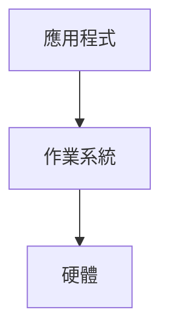

# Marginalia

[](https://github.com/Yuankai619/marginalia/actions/workflows/ci.yml)

Marginalia turns lecture slides and recordings into study notes, with each explanation linked back to the moment the teacher said it.

<!-- Screenshot placeholder: the reader UI screenshot will be added at this path. -->


- Read slides and editable notes side by side.
- Click timestamps in notes to jump to the lecture video.
- Match slides across recordings: one video can cover several decks, and one deck can span several videos.
- Transcribe locally with faster-whisper, including lectures mixing English and Mandarin.
- Write notes through your own Claude subscription, with optional Codex review and chat. No API key required.
- Study with a built-in agent in Q&A, interview, or note-review mode.
- Export a read-only static site for sharing.

The interface, generated notes, and agent replies use Traditional Chinese (Taiwan). This README is in English.

> **Integration draft:** this guide covers the work in [pipeline #1](https://github.com/Yuankai619/marginalia/pull/1), [web #2](https://github.com/Yuankai619/marginalia/pull/2), [API #4](https://github.com/Yuankai619/marginalia/pull/4), and [notes #5](https://github.com/Yuankai619/marginalia/pull/5). The pipeline is now on `main`; the other features are not all merged yet. Some web interactions are still previews, note format v2 is being implemented, and static data export is not wired up. The setup and end-to-end commands must be rechecked after integration.

## Requirements

| Tool | Purpose / version |
| --- | --- |
| Node.js | Use Node 22, matching CI. The root package does not declare an `engines` minimum. |
| pnpm | 10.17.0, pinned by `package.json`'s `packageManager`. |
| Python + uv | Python 3.12 (`server/.python-version`) and [uv](https://docs.astral.sh/uv/getting-started/installation/). |
| LibreOffice | `soffice` or `libreoffice` on `PATH` converts PowerPoint and other non-PDF decks to PDF. Not needed for PDF-only inputs. |
| Poppler | `pdftoppm`, `pdfinfo`, and `pdftotext` render and extract PDF slides. |
| FFmpeg | Audio extraction and video frames. If `ffmpeg` is absent from `PATH`, the backend uses imageio-ffmpeg's bundled executable. |
| Claude Code | Install the [CLI](https://code.claude.com/docs/en/setup) and sign in with your subscription. Verify with `claude auth status`. Required for the default note writer and reviewers. |
| Codex (optional) | A logged-in Codex CLI provides another chat engine and an optional second correctness reviewer. It does not replace the default Claude note writer. |

A GPU is optional. Whisper uses automatic device selection and int8 computation. As a rough planning estimate, a two-hour recording takes about one hour with `large-v3-turbo` on a 12-core CPU; actual time depends on the processor, audio, and thread count. The first transcription downloads the model and needs network access and disk space.

### Ubuntu / Debian

Install the system tools:

```sh
sudo apt-get update
sudo apt-get install -y git curl ca-certificates libreoffice poppler-utils ffmpeg
```

Install Node 22 with [nvm's official installer](https://github.com/nvm-sh/nvm#install--update-script), then pnpm:

```sh
curl -fsSL https://raw.githubusercontent.com/nvm-sh/nvm/v0.40.8/install.sh | bash
```

Open a new terminal so nvm is available, then run:

```sh
nvm install 22
nvm use 22
npm install --global pnpm@10.17.0
```

Install uv and Claude Code with their [official uv](https://docs.astral.sh/uv/getting-started/installation/) and [Claude Code](https://code.claude.com/docs/en/setup) installers:

```sh
curl -LsSf https://astral.sh/uv/install.sh | sh
curl -fsSL https://claude.ai/install.sh | bash
```

Open a new terminal to load the updated `PATH`, then finish setup:

```sh
uv python install 3.12
claude auth login
claude auth status
```

### macOS (Homebrew)

With [Homebrew](https://brew.sh/) installed:

```sh
brew install git node@22 uv poppler ffmpeg
brew install --cask libreoffice claude-code
export PATH="$(brew --prefix node@22)/bin:$PATH"
npm install --global pnpm@10.17.0
uv python install 3.12
claude auth login
claude auth status
```

Keep the Node `PATH` setting in your shell startup file for future terminals. If `soffice` is not on `PATH`, add `/Applications/LibreOffice.app/Contents/MacOS` too.

## Install

```sh
git clone https://github.com/Yuankai619/marginalia.git
cd marginalia
pnpm install
(cd server && uv sync)
```

Run `pnpm` commands from the repository root and `uv run marginalia ...` commands from `server/`, unless a command explicitly changes directories.

## Quick start

1. From the repository root, create a course directory:

   ```sh
   mkdir -p courses/operating-system/materials
   ```

2. Put your `.pptx` / `.pdf` slides and `.mp4` lecture recordings there. Subfolders and `.zip` bundles work too. Use files you have permission to process.
3. Scan the files so the course has a manifest:

   ```sh
   (cd server && uv run marginalia scan operating-system)
   ```

4. Start the local backend and web app:

   ```sh
   pnpm dev
   ```

5. Open <http://localhost:5173> and choose the course. **開始生成** (Generate) is the intended UI entry point for processing and progress, but the API-to-pipeline job wiring is still incomplete in this draft. Use the CLI command below to process the course until that integration lands.

The course page also has a drag-and-drop upload preview; use the folder-and-scan route above until uploads are connected. Processing can start CPU-intensive transcription and consume your Claude subscription allowance.

To process a deck from the CLI, first find its ID in `courses/operating-system/generated/manifest.json`, then run from `server/`:

```sh
uv run marginalia process operating-system --deck l1-operating-systems-a-recap
```

That deck ID is an example: replace it with one in your manifest. Rendering is reused when current. `process` reuses completed transcripts only when their recorded source path, size, and modification time match the source file; changed sources and legacy transcripts without a fingerprint are transcribed again. Rerunning also fills in missing notes. It aligns against all course videos even when a single deck is selected. The current pipeline calls the note writer when installed; automated review is a separate job, not a step currently invoked by `process`.

## Course files

```text
courses/<course-id>/
  course.json
  materials/                         original slides, recordings, and ZIPs
    _extracted/<zip-name>/           automatically unpacked bundles
  generated/                         rebuildable data
    manifest.json                    registered deck and video IDs
    decks/<deck-id>/
      deck.pdf
      slides.json                    slide text and speaker notes
      slides/001.webp
      thumbs/001.webp
    videos/<video-id>/
      transcript.json
      transcript.partial.json        available while transcription runs
      frames.npz
    alignment.json
    reviews/<deck-id>/001.json
  notes/<deck-id>/
    001.md                           editable study notes
    assets/                          note images (v2)
  chats/<chat-id>.json
```

Course data is git-ignored. Keep original materials and your notes backed up. IDs are derived from filenames, such as `L1 Operating Systems A Recap.pptx` → `l1-operating-systems-a-recap`. Slides are numbered from 1; filenames use three digits. Use the manifest's IDs when configuring URLs or choosing CLI targets.

A course can exist without `course.json`. To customize it, create `courses/<course-id>/course.json`:

```json
{
  "title": "Operating Systems",
  "language": "en+zh-TW",
  "hiddenDecks": ["extra-reading"],
  "videoUrls": {
    "os20260916": "https://media.example.org/os20260916.mp4"
  }
}
```

| Field | Meaning / default |
| --- | --- |
| `title` | Course display name; defaults to a title derived from the course directory ID. |
| `language` | Course language metadata; defaults to `en+zh-TW`. |
| `hiddenDecks` | Deck IDs to exclude from normal presentation/context where supported; defaults to `[]`. This is not an access-control setting. |
| `videoUrls` | Video ID → public playback URL for static deployment; defaults to `{}`. Use a URL the browser can play directly. |

ZIPs are unpacked once into `materials/_extracted/<zip-name>/` during scanning; an existing extraction directory is reused. Files need no special arrangement by lecture: visual alignment matches recordings against slides across decks, so recordings and decks do not have to pair one-to-one.

## CLI reference

Run these commands from `server/`. This reference was checked against the merged CLI's actual `--help` output on `main`.

```sh
uv run marginalia --help
uv run marginalia scan --help
uv run marginalia render --help
uv run marginalia align --help
uv run marginalia transcribe --help
uv run marginalia process --help
```

Every subcommand takes a required `course` directory ID. `-h` / `--help` prints help. `--deck` and `--video` can be repeated; omitting them selects all applicable items.

| Command | Arguments and options | Example |
| --- | --- | --- |
| `scan` | `course` | `uv run marginalia scan operating-system` |
| `render` | `course [--deck DECKS]` | `uv run marginalia render operating-system --deck l1 --deck l2` |
| `align` | `course [--video VIDEOS]` | `uv run marginalia align operating-system --video os20260916` |
| `transcribe` | `course [--video VIDEOS]` | `uv run marginalia transcribe operating-system --video os20260916` |
| `process` | `course [--deck DECKS]` | `uv run marginalia process operating-system --deck l1` |

- `scan` unpacks ZIPs and updates the materials manifest. Run it before individual processing commands after adding files.
- `render` converts selected decks to slide images, thumbnails, and extracted text.
- `align` matches selected videos against rendered course slides and saves time ranges. Manual corrections survive re-alignment.
- `transcribe` runs local Whisper for selected videos. It can be expensive; unlike `process`, calling this command directly does not skip an already completed transcript.
- `process` scans, renders missing or invalidated deck outputs, aligns videos, transcribes recordings without a current transcript, and generates notes. With `--deck`, transcription includes recordings matched to those decks, audio-only recordings, and videos whose deck membership is unknown. Other decks must already be rendered to participate in a cross-deck match when only one deck is selected.

There are currently no `generate`, `review`, `export`, or `serve` CLI subcommands, and no CLI `--force`, `--model`, or `--device` options. Note generation/review are also available as backend jobs; do not confuse job kinds with CLI commands.

## Configuration

Set environment variables before starting the backend or a CLI command. These are all the `MARGINALIA_*` variables in [config.py](server/marginalia/config.py):

| Variable | Default | Purpose |
| --- | --- | --- |
| `MARGINALIA_ROOT` | Repository root, derived from `config.py` | Base directory used to choose the default courses directory. |
| `MARGINALIA_COURSES` | `<MARGINALIA_ROOT>/courses` | Directory containing course folders. Prefer an absolute path. |
| `MARGINALIA_WHISPER_MODEL` | `large-v3-turbo` | faster-whisper model name. |
| `MARGINALIA_WHISPER_THREADS` | `max(1, (os.cpu_count() or 4) - 2)` | CPU threads for Whisper. Use a positive integer. |
| `MARGINALIA_WRITER_MODEL` | `opus` | Claude model alias for note writing and revision. |
| `MARGINALIA_REVIEW_MODEL` | `sonnet` | Claude model alias for automatic reviewers. |
| `MARGINALIA_CHAT_MODEL` | `sonnet` | Configured chat model default; the current chat handler separately defaults to `sonnet`, and an explicit request model takes precedence. |
| `MARGINALIA_GEN_CONCURRENCY` | `4` | Concurrent note-generation/review calls. Use a positive integer; more concurrency can exhaust your allowance sooner. |

For example, from the repository root:

```sh
MARGINALIA_COURSES=/absolute/path/to/courses pnpm dev
```

Or, from `server/`:

```sh
MARGINALIA_WHISPER_THREADS=6 uv run marginalia transcribe operating-system --video os20260916
```

The web adapter has separate build-time settings: `VITE_MARGINALIA_MODE=static` selects static JSON instead of the local API; otherwise it uses local mode. `VITE_MARGINALIA_MOCK=true` selects development mock data in local mode. Setting static mode alone does not export course data.

## How notes are generated

The full workflow is **scan → render → align → transcribe → generate → review**:

| Step | Runs where | Result |
| --- | --- | --- |
| Scan | Local Python | Unpacked ZIPs and manifest. |
| Render | Local LibreOffice + Poppler | PDF, slide images, thumbnails, text, speaker notes. |
| Align | Local FFmpeg + NumPy | Video time ranges mapped to deck/slide pairs. |
| Transcribe | Local faster-whisper | Timestamped speech segments; no paid transcription API. |
| Generate | Your logged-in Claude Code subscription | One note per slide using its image, text, nearby titles, deck outline, and aligned transcript ranges. |
| Review | Local rules + your Claude subscription; optional Codex | Correctness, style, and coverage findings, followed by revision when needed. |

The current `process` command covers the first five steps; review is separate. The UI/API job integration is still being completed.

Subscription usage is not a fixed token budget. The writer makes approximately one model call per taught slide; review adds three Claude calls per note and up to one revision call, plus an optional Codex correctness call. A 50-slide deck therefore means roughly 50 writer calls and 150 reviewer calls, with up to 50 revisions. Automatically skipped slides reduce this. Context length, images, retries, and chat change the actual allowance used. Try one small deck first; the default writer is Opus. Speech recognition and alignment use local compute and no model-subscription tokens.

"Local" describes orchestration, transcription, alignment, and file storage. Writing, review, and chat send relevant course text/images to the selected model provider through the logged-in CLI.

### Note states and editing

| State | Meaning |
| --- | --- |
| `generated` | Written by the note writer. |
| `reviewed` | Automatic review has run; findings live under `generated/reviews/`. |
| `edited` | Saved by the user through the editor. |
| `skipped` | The slide was not taught; the note contains a brief reason. |

**Normal generation and review never overwrite `edited` notes.** If you edit Markdown directly on disk, set its frontmatter to `status: edited` yourself. Internal generation/review functions support an explicit force override; the CLI has no such flag. Review can still record findings for an edited note without changing its text.

### Markdown format

Notes are plain Markdown with YAML frontmatter:

````markdown
---
slide: 7
title: Roles of Operating System (OS)
status: generated
sources:
  - os20260916@846-1062
updatedAt: 2026-11-03T10:00:00+08:00
---

> [!IMPORTANT]
> **作業系統**協調應用程式對硬體資源的使用。

老師用中介層來說明這個角色 [14:06](video:os20260916?t=846)。

==應用程式透過作業系統使用硬體資源。==




````

The timestamp syntax is `[mm:ss](video:<video-id>?t=<seconds>)`, also allowing an hour in the label. These links are intended to seek the corresponding video. The current web draft only opens a player preview showing the selected time; actual video playback and seeking still need integration.

Note format v2 adds Mermaid diagrams, `==highlight==`, bold terms, GitHub alerts (`NOTE`, `TIP`, `IMPORTANT`, `WARNING`, `CAUTION`), GFM comparison tables, `$...$` / `$$...$$` math, and images under `notes/<deck-id>/assets/` (`.png`, `.jpg`, `.webp`, `.svg`). Image links use `assets/<filename>`; SVGs are intended to render as images rather than inline SVG. These v2 features are pending integration in this draft. See the [architecture contract](docs/architecture.md) for the merged format and the note writer's `server/marginalia/notes/style.md` once the notes branch lands.

## The agent panel

The course reader is designed to offer three modes:

| Mode | What to ask |
| --- | --- |
| Q&A / 問答 | Explain the current slide, connect concepts across decks, or clarify a selected passage. |
| Interview / 口試 | Ask one understanding question at a time, wait for your answer, then give feedback and a follow-up. |
| Review / 審稿 | Check the current note against the slides and transcript, with concrete corrections and timestamps. |

Drag across a slide to mark a region, or select text in a note/transcript, then ask about it in the panel. The intended account/model controls choose a detected Claude or Codex login, model, and reasoning effort. The backend supports these request fields, but the current web panel is a preview: sending messages, forwarding selections, and account/model controls are not yet fully connected.

The agent's supplied context belongs to the current course: its slide outline, current slide, notes, aligned transcript, and selection. It works from that course directory with read-only tools; this describes the intended course scope, not a guarantee of filesystem isolation. It does not edit your notes through chat. Conversations are stored in that course's `chats/` directory. Model requests still use the selected provider's service.

## Deploying a static reader

The architecture defines this build command from the repository root:

```sh
pnpm build
```

The intended output is `apps/web/dist/`, containing a read-only reader plus exported course data. Editing, generation, and agent chat require the local backend and are hidden in static mode.

**Static export is not implemented in the branches checked for this draft.** The current web build compiles frontend assets but does not yet export courses or automatically select static mode. Do not deploy that output expecting a complete course reader until export integration lands.

The export contract includes slides, thumbnails, notes, course/deck JSON, and transcripts. It excludes original `materials/` files and lecture video binaries. V2 note assets must also be handled by the exporter before publishing illustrated notes. Your course data may therefore become public even though `courses/` is git-ignored. Check teaching-material rights and inspect the build output before deploying it.

For video playback, set `videoUrls` in `course.json` before export, mapping the manifest's video IDs to directly playable hosted media. Local `/files/...` URLs require the backend and will not work on a static host. Without a public URL, the static reader is intended to show timestamps as text.

## Skills and coding-agent integration

The repository currently contains no `.claude/skills` or other installable agent skills. [AGENTS.md](AGENTS.md) gives coding agents the project rules; [docs/architecture.md](docs/architecture.md) defines the frontend/backend/disk contract.

Open this repository in Claude Code or Codex and ask it to read those files first. For example:

> Read AGENTS.md and docs/architecture.md, scan my operating-system course, and show me its deck IDs. Before starting transcription or using my subscription to generate notes, explain which deck you will process.

Once you choose a deck, an agent can run `uv run marginalia process operating-system --deck <deck-id>` from `server/`. There is no special `/marginalia` skill or slash command. Course content must stay out of commits; use your logged-in subscription rather than adding API keys.

## Troubleshooting

| Symptom | What to check |
| --- | --- |
| Cannot convert PPTX / “需要 LibreOffice” | Install LibreOffice and make `soffice` or `libreoffice` visible on `PATH`. On macOS, add `/Applications/LibreOffice.app/Contents/MacOS`. A PDF input bypasses this conversion. |
| `pdftoppm`, `pdfinfo`, or `pdftotext` not found | Install `poppler-utils` on Ubuntu/Debian or `poppler` with Homebrew, then reopen your terminal. |
| Claude login/model calls fail | Run `claude auth status`, then `claude auth login` if needed. Check subscription allowance and that the selected model is available to your account. |
| CUDA unavailable / transcription uses CPU | A GPU is optional. With no usable CUDA device, automatic device selection uses CPU; slower processing is expected. If CUDA libraries are detected but incompatible and startup fails, fix the CTranslate2/CUDA installation; the application does not implement its own retry-on-CPU loop. |
| CPU is saturated | Lower `MARGINALIA_WHISPER_THREADS` before starting a job. Avoid simultaneous transcription runs, including jobs in another checkout. |
| Port 8765 or 5173 is occupied | Check existing local dev servers. Stop only a server you started, or reuse it. The current launcher/proxy expects backend port 8765; Vite normally starts on 5173 but may report a different available port. |
| Course or deck does not appear | Confirm `materials/` exists under the courses root, rerun `scan`, inspect `generated/manifest.json`, and check `MARGINALIA_COURSES`. |
| Alignment points to the wrong page | In local mode, open the course's **影片對齊** timeline, click the relevant segment, and enter the correct slide number. Saved manual segments survive reruns. The current editor changes the page within the existing deck; cross-deck correction is supported by the API contract but needs further UI integration. |
| Static site shows missing courses or broken video links | Confirm the exporter is actually implemented and course data is included. Check `videoUrls`; compiling the frontend alone does not package the courses. |

## Development

Read [AGENTS.md](AGENTS.md) and the [architecture contract](docs/architecture.md) before changing interfaces or on-disk formats. Update the contract in the same PR when an interface changes. Use tiny generated fixtures in tests, and keep real slides, recordings, transcripts, and notes out of git.

Start both services with `pnpm dev`. The backend listens on `127.0.0.1:8765`; Vite proxies `/api` and `/files` to it.

Run the pre-push checks from the repository root:

```sh
pnpm check
(cd server && uv run ruff check . && uv run pytest -q)
```

[CI](.github/workflows/ci.yml) runs on PRs and pushes to `main`: backend dependency sync, Ruff, and pytest; frontend install, check, and build on Node 22 when the web package exists. Backend lint failures fail CI. The bootstrap workflow treats an empty test suite as a skip and skips web checks/build before scaffolding is merged. The current backend has a test suite; these skips do not mean the full application has passed end-to-end validation.

## License

[MIT](LICENSE). Copyright (c) 2026 Yuankai619.
