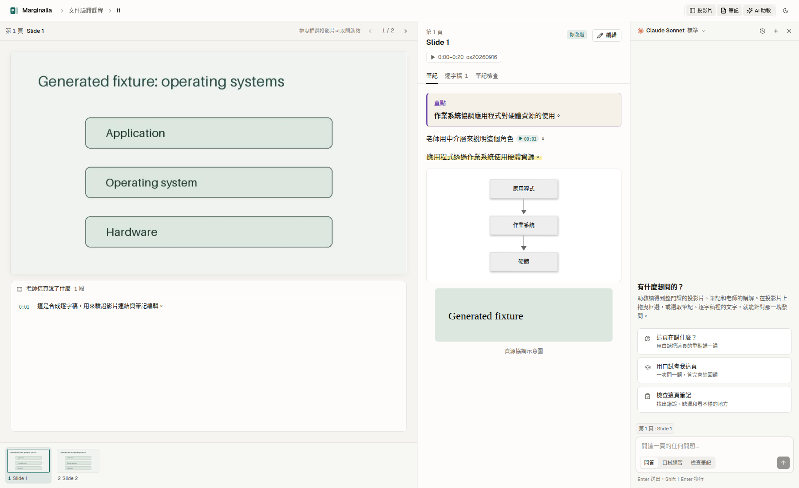
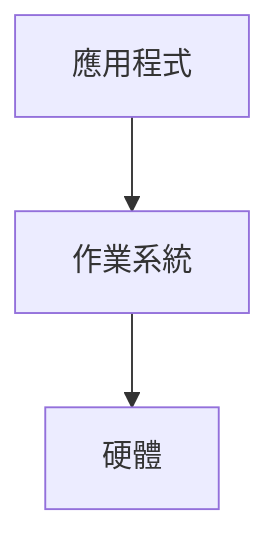

# Marginalia

[](https://github.com/Yuankai619/marginalia/actions/workflows/ci.yml)

Marginalia turns lecture slides and recordings into study notes, with each explanation linked back to the moment the teacher said it.



- Read slides and editable notes side by side.
- Click timestamps in notes to jump to the lecture video.
- Match slides across recordings: one video can cover several decks, and one deck can span several videos.
- Transcribe locally with faster-whisper, including lectures mixing English and Mandarin.
- Write notes through your own Claude subscription, with optional Codex review and chat. No API key required.
- Study with a built-in agent in Q&A, interview, or note-review mode.
- Export a read-only static site for sharing.

The interface, generated notes, and agent replies use Traditional Chinese (Taiwan). This README is in English.

> `pnpm dev` runs the local workspace; `pnpm build` exports a complete read-only course reader for static hosting.

## Requirements

| Tool | Purpose / version |
| --- | --- |
| Node.js | Use Node 22, matching CI. The root package does not declare an `engines` minimum. |
| pnpm | 10.17.0, pinned by `package.json`'s `packageManager`. |
| Python + uv | Python 3.12 (`server/.python-version`) and [uv](https://docs.astral.sh/uv/getting-started/installation/). |
| LibreOffice | `soffice` or `libreoffice` on `PATH` converts PowerPoint and other non-PDF decks to PDF. Not needed for PDF-only inputs. |
| Poppler | `pdftoppm`, `pdfinfo`, and `pdftotext` render and extract PDF slides. |
| FFmpeg | Audio extraction and video frames. If `ffmpeg` is absent from `PATH`, the backend uses imageio-ffmpeg's bundled executable. |
| Claude Code | Install the [CLI](https://code.claude.com/docs/en/setup) and sign in with your subscription. Verify with `claude auth status`. Required for the default note writer and reviewers. |
| Codex (optional) | A logged-in Codex CLI provides another chat engine and an optional second correctness reviewer. It does not replace the default Claude note writer. |

A GPU is optional. Whisper uses automatic device selection and int8 computation. As a rough planning estimate, a two-hour recording takes about one hour with `large-v3-turbo` on a 12-core CPU; actual time depends on the processor, audio, and thread count. The first transcription downloads the model and needs network access and disk space.

### Ubuntu / Debian

Install the system tools:

```sh
sudo apt-get update
sudo apt-get install -y git curl ca-certificates libreoffice poppler-utils ffmpeg
```

Install Node 22 with [nvm's official installer](https://github.com/nvm-sh/nvm#install--update-script), then pnpm:

```sh
curl -fsSL https://raw.githubusercontent.com/nvm-sh/nvm/v0.40.8/install.sh | bash
```

Open a new terminal so nvm is available, then run:

```sh
nvm install 22
nvm use 22
npm install --global pnpm@10.17.0
```

Install uv and Claude Code with their [official uv](https://docs.astral.sh/uv/getting-started/installation/) and [Claude Code](https://code.claude.com/docs/en/setup) installers:

```sh
curl -LsSf https://astral.sh/uv/install.sh | sh
curl -fsSL https://claude.ai/install.sh | bash
```

Open a new terminal to load the updated `PATH`, then finish setup:

```sh
uv python install 3.12
claude auth login
claude auth status
```

### macOS (Homebrew)

With [Homebrew](https://brew.sh/) installed:

```sh
brew install git node@22 uv poppler ffmpeg
brew install --cask libreoffice claude-code
export PATH="$(brew --prefix node@22)/bin:$PATH"
npm install --global pnpm@10.17.0
uv python install 3.12
claude auth login
claude auth status
```

Keep the Node `PATH` setting in your shell startup file for future terminals. If `soffice` is not on `PATH`, add `/Applications/LibreOffice.app/Contents/MacOS` too.

## Install

```sh
git clone https://github.com/Yuankai619/marginalia.git
cd marginalia
pnpm install
(cd server && uv sync)
```

Run `pnpm` commands from the repository root and `uv run marginalia ...` commands from `server/`, unless a command explicitly changes directories.

## Quick start

1. From the repository root, create a course directory:

   ```sh
   mkdir -p courses/operating-system/materials
   ```

2. Put your `.pptx` / `.pdf` slides and `.mp4` lecture recordings there. Subfolders and `.zip` bundles work too. Use files you have permission to process.
3. Scan the files so the course has a manifest:

   ```sh
   (cd server && uv run marginalia scan operating-system)
   ```

4. Start the local backend and web app:

   ```sh
   pnpm dev
   ```

5. Open <http://localhost:5173>, choose the course, click **產生筆記** (Generate notes), choose the decks, then click **開始** (Start) and follow the job progress. When processing finishes, open a deck to read its slides and notes.

The course page also supports drag-and-drop uploads and **重新掃描** (Rescan). The folder-and-scan route above works from the CLI too. Processing can start CPU-intensive transcription and consume your Claude subscription allowance.

To process a deck from the CLI, first find its ID in `courses/operating-system/generated/manifest.json`, then run from `server/`:

```sh
uv run marginalia process operating-system --deck l1-operating-systems-a-recap
```

That deck ID is an example: replace it with one in your manifest. Rendering is reused when current. `process` reuses completed transcripts only when their recorded source path, size, and modification time match the source file; changed sources and legacy transcripts without a fingerprint are transcribed again. Rerunning also fills in missing notes. It aligns against all course videos even when a single deck is selected. The pipeline now includes the note writer; automated review is separate and is not invoked by `process`.

### Access from another device

Bind Vite to this computer's Tailscale IP, replacing the example with your own:

```sh
MARGINALIA_ALLOWED_ORIGINS="http://localhost:5173,http://127.0.0.1:5173,http://100.81.100.96:5173" pnpm dev -- --host 100.81.100.96
```

Open `http://100.81.100.96:5173` from another device on the same tailnet. Do not bind to `0.0.0.0` or a public IP: the development interface has no login protection and exposes course files and the local agent through its proxy. `--host` is passed only to Vite; the backend remains on `127.0.0.1:8765`. Keep `changeOrigin: true` on both `/api` and `/files` proxies so backend TrustedHost checks accept requests from the other device.

## Course files

```text
courses/<course-id>/
  course.json
  materials/                         original slides, recordings, and ZIPs
    _extracted/<zip-name>/           automatically unpacked bundles
  generated/                         rebuildable data
    manifest.json                    registered deck and video IDs
    decks/<deck-id>/
      deck.pdf
      slides.json                    slide text and speaker notes
      slides/001.webp
      thumbs/001.webp
    videos/<video-id>/
      transcript.json
      transcript.partial.json        available while transcription runs
      frames.npz
    alignment.json
    reviews/<deck-id>/001.json
  notes/<deck-id>/
    001.md                           editable study notes
    assets/                          note images (v2)
  chats/<chat-id>.json
```

Course data is git-ignored. Keep original materials and your notes backed up. IDs are derived from filenames, such as `L1 Operating Systems A Recap.pptx` → `l1-operating-systems-a-recap`. Slides are numbered from 1; filenames use three digits. Use the manifest's IDs when configuring URLs or choosing CLI targets.

A course can exist without `course.json`. To customize it, create `courses/<course-id>/course.json`:

```json
{
  "title": "Operating Systems",
  "language": "en+zh-TW",
  "hiddenDecks": ["extra-reading"],
  "videoUrls": {
    "os20260916": "https://media.example.org/os20260916.mp4"
  }
}
```

| Field | Meaning / default |
| --- | --- |
| `title` | Course display name; defaults to a title derived from the course directory ID. |
| `language` | Course language metadata; defaults to `en+zh-TW`. |
| `hiddenDecks` | Deck IDs to hide in the local reader/context and omit from static exports; defaults to `[]`. This is not local access control. |
| `videoUrls` | Video ID → public playback URL for static deployment; defaults to `{}`. Use a URL the browser can play directly. |

ZIPs are unpacked once into `materials/_extracted/<zip-name>/` during scanning; an existing extraction directory is reused. Files need no special arrangement by lecture: visual alignment matches recordings against slides across decks, so recordings and decks do not have to pair one-to-one.

## CLI reference

Run these commands from `server/`. This reference was checked against the merged CLI's actual `--help` output on `main`.

```sh
uv run marginalia --help
uv run marginalia scan --help
uv run marginalia render --help
uv run marginalia align --help
uv run marginalia transcribe --help
uv run marginalia process --help
```

Every subcommand takes a required `course` directory ID. `-h` / `--help` prints help. `--deck` and `--video` can be repeated; omitting them selects all applicable items.

| Command | Arguments and options | Example |
| --- | --- | --- |
| `scan` | `course` | `uv run marginalia scan operating-system` |
| `render` | `course [--deck DECKS]` | `uv run marginalia render operating-system --deck l1 --deck l2` |
| `align` | `course [--video VIDEOS]` | `uv run marginalia align operating-system --video os20260916` |
| `transcribe` | `course [--video VIDEOS]` | `uv run marginalia transcribe operating-system --video os20260916` |
| `process` | `course [--deck DECKS]` | `uv run marginalia process operating-system --deck l1` |
| `export` | `[course ...] --out DIRECTORY [--deck DECKS]` | `uv run marginalia export operating-system --out /tmp/reader-data` |

- `scan` unpacks ZIPs and updates the materials manifest. Run it before individual processing commands after adding files.
- `render` converts selected decks to slide images, thumbnails, and extracted text.
- `align` matches selected videos against rendered course slides and saves time ranges. Manual corrections survive re-alignment.
- `transcribe` runs local Whisper for selected videos. It can be expensive; unlike `process`, calling this command directly does not skip an already completed transcript.
- `process` scans, renders missing or invalidated deck outputs, aligns videos, transcribes recordings without a current transcript, and generates notes. With `--deck`, transcription includes recordings matched to those decks, audio-only recordings, and videos whose deck membership is unknown. Other decks must already be rendered to participate in a cross-deck match when only one deck is selected.

There are currently no `generate`, `review`, or `serve` CLI subcommands, and no CLI `--force`, `--model`, or `--device` options. Note generation/review are also available as backend jobs; do not confuse job kinds with CLI commands.

## Configuration

Set environment variables before starting the backend or a CLI command. Backend settings come from [config.py](server/marginalia/config.py) and [api.py](server/marginalia/api.py); the Vite proxy setting comes from [vite.config.ts](apps/web/vite.config.ts):

| Variable | Default | Purpose |
| --- | --- | --- |
| `MARGINALIA_ROOT` | Repository root, derived from `config.py` | Base directory used to choose the default courses directory. |
| `MARGINALIA_COURSES` | `<MARGINALIA_ROOT>/courses` | Directory containing course folders. Prefer an absolute path. |
| `MARGINALIA_WHISPER_MODEL` | `large-v3-turbo` | faster-whisper model name. |
| `MARGINALIA_WHISPER_THREADS` | `max(1, (os.cpu_count() or 4) - 2)` | CPU threads for Whisper. Use a positive integer. |
| `MARGINALIA_WRITER_MODEL` | `opus` | Claude model alias for note writing and revision. |
| `MARGINALIA_REVIEW_MODEL` | `sonnet` | Claude model alias for automatic reviewers. |
| `MARGINALIA_CHAT_MODEL` | `sonnet` | Configured chat model default; the current chat handler separately defaults to `sonnet`, and an explicit request model takes precedence. |
| `MARGINALIA_GEN_CONCURRENCY` | `4` | Concurrent note-generation/review calls. Use a positive integer; more concurrency can exhaust your allowance sooner. |
| `MARGINALIA_ALLOWED_ORIGINS` | `http://localhost:5173,http://127.0.0.1:5173` | Comma-separated browser origins allowed to make requests that change data. Replaces the default list; restart the server after changing it. |
| `MARGINALIA_EXPORT_COURSES` | All courses | Comma-separated course IDs to include in the root static build. |
| `VITE_BASE_PATH` | `/` | Build URL prefix, with a trailing slash (e.g. `/marginalia/`). |
| `MARGINALIA_API` | `http://127.0.0.1:8765` | Vite development proxy target for `/api` and `/files`; use it when running a separate backend on another port. |

Origins must include the scheme, hostname, and port when needed, with no path, trailing slash, or wildcard. Surrounding whitespace and empty entries are ignored. Same-origin requests and CLI requests without an `Origin` header are always allowed. An empty setting allows only those requests. See the Tailscale example above when accessing the reader from another device.

For example, from the repository root:

```sh
MARGINALIA_COURSES=/absolute/path/to/courses pnpm dev
```

Or, from `server/`:

```sh
MARGINALIA_WHISPER_THREADS=6 uv run marginalia transcribe operating-system --video os20260916
```

The web adapter uses `VITE_MARGINALIA_MODE`: `static` reads exported JSON, `mock` explicitly enables demo data and simulated agent replies, and the default uses the local API. `pnpm build` sets static mode automatically. The root build command also exports course data after Vite finishes.

## How notes are generated

The full workflow is **scan → render → align → transcribe → generate → review**:

| Step | Runs where | Result |
| --- | --- | --- |
| Scan | Local Python | Unpacked ZIPs and manifest. |
| Render | Local LibreOffice + Poppler | PDF, slide images, thumbnails, text, speaker notes. |
| Align | Local FFmpeg + NumPy | Video time ranges mapped to deck/slide pairs. |
| Transcribe | Local faster-whisper | Timestamped speech segments; no paid transcription API. |
| Generate | Your logged-in Claude Code subscription | One note per slide using its image, text, nearby titles, deck outline, and aligned transcript ranges. |
| Review | Local rules + your Claude subscription; optional Codex | Correctness, style, and coverage findings, followed by revision when needed. |

The `process` command and the UI pipeline job cover the first five steps. Automatic review is a separate backend job; the agent panel's review mode gives on-demand feedback.

Subscription usage is not a fixed token budget. The writer makes approximately one model call per taught slide; review adds three Claude calls per note and up to two revision calls, plus an optional Codex correctness call. A 50-slide deck therefore means roughly 50 writer calls and 150 reviewer calls, with up to 100 revision calls. Automatically skipped slides reduce this. Context length, images, retries, and chat change the actual allowance used. Try one small deck first; the default writer is Opus. Speech recognition and alignment use local compute and no model-subscription tokens.

"Local" describes orchestration, transcription, alignment, and file storage. Writing, review, and chat send relevant course text/images to the selected model provider through the logged-in CLI.

### Note states and editing

| State | Meaning |
| --- | --- |
| `generated` | Written by the note writer. |
| `reviewed` | Required reviewers completed and no blocking rule findings remain; findings live under `generated/reviews/`. |
| `edited` | Saved by the user through the editor. |
| `skipped` | The slide was not taught; the note contains a brief reason. |

**Normal generation and review never overwrite `edited` notes.** A hand-written note without a `status` is protected in the same way. If you edit an existing generated Markdown file directly, change its frontmatter to `status: edited`. Writes also compare the file with the version the job started from, so a concurrent edit is kept. Internal generation/review functions support an explicit force override; the CLI has no such flag. Review can still record findings for an edited note without changing its text.

A note written while alignment or transcription is incomplete carries `partial: true` and an `inputs` content fingerprint. Rerunning generation refreshes it only when its own ranges, transcript content/completeness, or pending videos change. Courses without recordings, audio-only courses, and decks with no aligned video after alignment completes get final slide-only notes.

Review leaves a note as `generated` when blocking findings remain after at most two revision rounds. Notes longer than 20,000 characters receive local rule checks only and are never automatically rewritten by the reviewer. Review records include hashes of the reviewed and final note text; a record that matches neither version is stale.

### Markdown format

Notes are plain Markdown with YAML frontmatter. This example includes a user-added image:

````markdown
---
slide: 7
title: Roles of Operating System (OS)
status: edited
sources:
  - os20260916@846-1062
updatedAt: 2026-11-03T10:00:00+08:00
---

> [!IMPORTANT]
> **作業系統**協調應用程式對硬體資源的使用。

老師用中介層來說明這個角色 [14:06](video:os20260916?t=846)。

==應用程式透過作業系統使用硬體資源。==




````

The timestamp syntax is `[mm:ss](video:<video-id>?t=<seconds>)`, also allowing an hour in the label. When the recording has a playback source, clicking a timestamp opens the corresponding video and seeks to that time. Without a source, the timestamp is shown as text.

Note format v2 adds Mermaid diagrams, `==highlight==`, bold terms, GitHub alerts (`NOTE`, `TIP`, `IMPORTANT`, `WARNING`, `CAUTION`), GFM comparison tables, `$...$` / `$$...$$` math, and images under `notes/<deck-id>/assets/` (`.png`, `.jpg`, `.webp`, `.svg`). Image links use `assets/<filename>`; SVGs are intended to render as images rather than inline SVG. The reader and editor preview render these v2 features. Mermaid follows the light/dark theme; click a diagram or image to enlarge it. Invalid Mermaid shows its source and an error message instead of breaking the note. Images must use a plain `assets/<filename>` path with no subfolders; other image URLs render as caption text. Generated notes use Mermaid rather than referencing nonexistent image files; asset images are supplied by the user. See the [architecture contract](docs/architecture.md) and [note-writing rules](server/marginalia/notes/style.md).

### Editing notes

In local mode, click **編輯** (Edit) on a note to open the CodeMirror Markdown editor. Type Markdown directly or use the toolbar for bold text, highlights, headings, lists, callouts, tables, and Mermaid diagrams. Choose **編輯** / **預覽** (Edit / Preview); **並排** (Split) is available when the notes pane is wide enough. The preview uses the same renderer as the reader.

- Save with **儲存** or Ctrl+S (Cmd+S on macOS). Ctrl+B adds bold; Ctrl+Shift+H wraps selected text in `==highlight==` (use Cmd instead of Ctrl on macOS).
- Paste or drop a PNG/JPG/WebP/SVG, or use **插入圖片** (Insert image). The editor uploads it to the deck's `assets/` folder and inserts its Markdown path. Files must match their type and be at most 10 MB. Wait for uploads to finish before saving; leaving a page offers to save or discard the draft.
- While editing, keep a recording open and play or scrub it to update **插入目前時間** (Insert current time). The toolbar inserts a link to the player's reported position.
- **完成** (Done) returns to reading. Unsaved changes trigger a confirmation when you leave; saved notes become `edited` and are protected from generation.

Use the **筆記檢查** (Note checks) tab to read review findings as cards: issues that still need attention, automatically fixed findings, and small suggestions. The tab indicates incomplete checks and hides findings for an outdated note. Automatic review is a separate job; this tab displays its results.

## The agent panel

Toggle **投影片**, **筆記**, and **AI 助教** in the top bar to show or hide panes; drag the dividers to resize them. On a narrow screen, switch between panes with the mobile controls. The assistant offers three modes:

| Mode | What to ask |
| --- | --- |
| Q&A / 問答 | Explain the current slide, connect concepts across decks, or clarify a selected passage. |
| Interview / 口試練習 | Ask one understanding question at a time, wait for your answer, then give feedback and a follow-up. |
| Review / 檢查筆記 | Check the current note against the slides and transcript, with concrete corrections and timestamps. |

Drag across a slide to mark a region, or select text in a note/transcript and click **問助教** (Ask assistant). The selected context appears in the **AI 助教** panel. Use the model menu in its header to choose a detected Claude or Codex login, model, and reasoning effort. The panel sends the current slide and selection to the local backend and streams its response. Explicit mock mode uses simulated replies instead of a model.

The backend supplies context from the current course: visible slides, speaker notes, per-slide notes, transcripts (including partial transcripts), and your selection. Context is limited to 120,000 characters, prioritizing the current slide; truncation is indicated. Claude's Read/Grep/Glob tools are restricted to this course's validated paths. Codex chat has no file-reading tools and relies on the supplied context. Chat does not edit your notes. Conversations are stored in that course's `chats/` directory, and model requests use the selected provider's service.

## Deploying a static reader

From the repository root, install the dependencies described above, then build:

```sh
pnpm build
pnpm --filter @marginalia/web exec vite preview --host 127.0.0.1 --port 5178
```

`apps/web/dist/` contains the frontend and an exported snapshot of every course under `MARGINALIA_COURSES` (default: `courses/`). If there are no courses or `uv` is not installed/on `PATH`, the build skips export, prints a one-line English warning, and produces a working frontend with an empty course index. Other export errors still fail the build. Editing, uploads, generation, account selection, and agent chat are hidden in the static reader.

Choose courses or a hosting subpath at build time:

```sh
MARGINALIA_COURSES=/path/to/courses MARGINALIA_EXPORT_COURSES=operating-system,another-course pnpm build
VITE_BASE_PATH=/marginalia/ pnpm build
```

`VITE_BASE_PATH` must be an absolute URL path with a trailing slash. Upload the contents of `apps/web/dist/` to that path. Configure your host to serve `index.html` for reader routes such as `/marginalia/c/operating-system/d/<deck>/7`. A `404.html` copy is included for GitHub Pages deep links. No backend is needed. SVG assets should be served with `Content-Security-Policy: default-src 'none'; style-src 'unsafe-inline'; img-src data:`; the reader HTML also carries its own CSP.

For a data-only export, run from `server/`:

```sh
uv run marginalia export operating-system --out /tmp/marginalia-snapshot
uv run marginalia export operating-system --deck l1-operating-systems-a-recap --out /tmp/marginalia-l1
```

Omit course IDs to export all courses. The output must have no existing `data/` or `files/` directory; use a new destination for each standalone snapshot. `pnpm build` recreates its own `dist/` before exporting, preventing removed or newly hidden content from surviving a rebuild.

The export includes visible decks, slide images and thumbnails, completed notes with their public status, referenced note images, final transcripts, and alignment ranges. It excludes `hiddenDecks`, unfinished/partial notes and transcripts, review records, chat history, local source paths, original `materials/`, and lecture video binaries. Note images are checked again during export, including SVG validation. Metadata is explicitly allowlisted; lesson text and authored note content remain as written, so inspect the snapshot and teaching-material rights before publishing.

For playback, set `videoUrls` in `course.json`, mapping video IDs to directly playable public HTTPS URLs. Local/private IPs, local hostnames, Tailscale names, and URLs with embedded credentials are excluded. Without an accepted public URL, timestamps appear as text. The exporter never downloads media.

To run the browser regression against actual exported synthetic courses:

```sh
(cd server && uv run python ../scripts/static-fixture.py /tmp/marginalia-fixture-courses)
MARGINALIA_COURSES=/tmp/marginalia-fixture-courses pnpm build
# Start the preview above, then use your existing Playwright installation:
NODE_PATH=/path/to/playwright/node_modules WEB_STATIC_ONLY=1 WEB_STATIC_URL=http://127.0.0.1:5178 node scripts/web-regression.cjs
```

## Skills and coding-agent integration

The repository currently contains no `.claude/skills` or other installable agent skills. [AGENTS.md](AGENTS.md) gives coding agents the project rules; [docs/architecture.md](docs/architecture.md) defines the frontend/backend/disk contract.

Open this repository in Claude Code or Codex and ask it to read those files first. For example:

> Read AGENTS.md and docs/architecture.md, scan my operating-system course, and show me its deck IDs. Before starting transcription or using my subscription to generate notes, explain which deck you will process.

Once you choose a deck, an agent can run `uv run marginalia process operating-system --deck <deck-id>` from `server/`. There is no special `/marginalia` skill or slash command. Course content must stay out of commits; use your logged-in subscription rather than adding API keys.

## Troubleshooting

| Symptom | What to check |
| --- | --- |
| Cannot convert PPTX / “需要 LibreOffice” | Install LibreOffice and make `soffice` or `libreoffice` visible on `PATH`. On macOS, add `/Applications/LibreOffice.app/Contents/MacOS`. A PDF input bypasses this conversion. |
| `pdftoppm`, `pdfinfo`, or `pdftotext` not found | Install `poppler-utils` on Ubuntu/Debian or `poppler` with Homebrew, then reopen your terminal. |
| Browser requests return 403 / “不允許此請求來源” | Set `MARGINALIA_ALLOWED_ORIGINS` to include the browser's full origin (scheme, host, and port), then restart the dev server. Use the Tailscale example above for another device. |
| Claude login/model calls fail | Run `claude auth status`, then `claude auth login` if needed. Check subscription allowance and that the selected model is available to your account. |
| CUDA unavailable / transcription uses CPU | A GPU is optional. With no usable CUDA device, automatic device selection uses CPU; slower processing is expected. If CUDA libraries are detected but incompatible and startup fails, fix the CTranslate2/CUDA installation; the application does not implement its own retry-on-CPU loop. |
| CPU is saturated | Lower `MARGINALIA_WHISPER_THREADS` before starting a job. Avoid simultaneous transcription runs, including jobs in another checkout. |
| Port 8765 or 5173 is occupied | Check existing local dev servers. Stop only a server you started, or reuse it. The launcher starts the backend on 8765; Vite normally starts on 5173 but may report a different available port. For a second checkout, use the separate-port recipe below. |
| Course or deck does not appear | Confirm `materials/` exists under the courses root, rerun `scan`, inspect `generated/manifest.json`, and check `MARGINALIA_COURSES`. |
| Alignment points to the wrong page | In local mode, expand the course's **錄影與投影片的對應** (Recording/slide mapping) timeline, click the relevant segment, and enter the correct slide number. Saved manual segments survive reruns. The current editor changes the page within the existing deck; cross-deck correction is supported by the API contract but needs further UI integration. |
| Static site shows missing courses or broken video links | Run the root `pnpm build` and inspect `dist/data/courses.json`. Check `MARGINALIA_COURSES`, `VITE_BASE_PATH`, the host route fallback, and public HTTPS `videoUrls`. |

## Development

Read [AGENTS.md](AGENTS.md) and the [architecture contract](docs/architecture.md) before changing interfaces or on-disk formats. Update the contract in the same PR when an interface changes. Use tiny generated fixtures in tests, and keep real slides, recordings, transcripts, and notes out of git.

Start both services with `pnpm dev`. The backend listens on `127.0.0.1:8765`; Vite proxies `/api` and `/files` to it.

If another checkout is already using the default ports, run a separate backend and frontend in two terminals from the repository root:

```sh
(cd server && MARGINALIA_ALLOWED_ORIGINS=http://localhost:5174,http://127.0.0.1:5174 uv run uvicorn marginalia.api:app --host 127.0.0.1 --port 8766)
```

```sh
MARGINALIA_API=http://127.0.0.1:8766 pnpm --filter @marginalia/web dev --host 127.0.0.1 --port 5174
```

Open <http://127.0.0.1:5174>. Both API and file requests use that checkout's backend.

Run the pre-push checks from the repository root:

```sh
pnpm check
(cd server && uv run ruff check . && uv run pytest -q)
```

[CI](.github/workflows/ci.yml) runs on PRs and pushes to `main`: backend dependency sync, Ruff, and pytest; frontend install, check, and build on Node 22 when the web package exists. Backend lint failures fail CI. The frontend check runs Biome, TypeScript, and unit tests for video links and note formatting/review records. For fixture-based browser regression coverage, see [apps/web/README.md](apps/web/README.md); it uses an existing Playwright installation and does not call models or process real courses.

## License

[MIT](LICENSE). Copyright (c) 2026 Yuankai619. See [third-party notices](apps/web/THIRD_PARTY_NOTICES.md) for adapted UI components.
