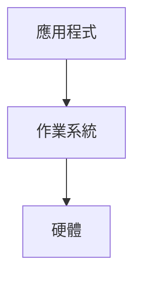

# Marginalia architecture

Marginalia turns lecture slides (pptx/pdf) and lecture recordings (mp4) into per-slide study notes.
Slides show on the left; notes on the right; every claim in a note links to the second of video where the
teacher said it. A local agent (the user's own Claude Code / Codex login, never an API key) answers questions
with the whole course as context.

## Two modes

| | `pnpm dev` (local) | `pnpm build` (deployed) |
| --- | --- | --- |
| Backend | Python FastAPI on 127.0.0.1:8765, Vite proxies `/api` and `/files` | none |
| Data | read/write files under `courses/` | static JSON + images exported into `apps/web/dist/` |
| Edit notes | yes | no (read-only) |
| Agent chat / generation | yes | hidden |
| Video | served from `courses/<c>/materials` with Range support | `course.json` `videoUrls[<video>]` if set, else timestamps show as text |

The frontend picks its data adapter from `import.meta.env.VITE_MARGINALIA_MODE` (`local` | `static`).

## Repo layout

```
apps/web/                 Vite + React 19 + TS + Tailwind 4 + shadcn (same stack as open-slide)
server/                   Python 3.12, uv
  marginalia/
    config.py store.py    paths, on-disk layout helpers (read store.py docstring first)
    ingest.py             scan materials/, unpack zips, register decks + videos
    slides.py             pptx/pdf -> PDF -> webp slides + per-slide text
    media.py              ffmpeg helpers
    transcribe.py         faster-whisper, local, multilingual (en + zh)
    align.py              which slide is on screen when (frame matching + Viterbi)
    pipeline.py           scan -> render -> align -> transcribe -> generate -> review, as a job
    llm/claude.py         one-shot calls through the local Claude Code login (claude-agent-sdk)
    llm/codex.py          one-shot calls through `codex exec` (optional second engine)
    llm/accounts.py       detect logged-in Claude / Codex accounts
    notes/                note writer, reviewer agents, prompts
    agents/               chat: Q&A, interview, on-demand review (streaming)
    jobs.py               background job runner + progress events
    api.py                FastAPI app
    export.py             static export used by `pnpm build`
    cli.py                `uv run marginalia <cmd>`
courses/                  user data, git-ignored (see store.py for the layout)
scripts/dev.mjs           runs uvicorn + vite together
```

## Course data on disk

See the docstring at the top of `server/marginalia/store.py`. Key points:

- `courses/<c>/materials/` raw drops. Any folder structure; zips are unpacked to `materials/_extracted/`.
- `courses/<c>/generated/` everything rebuildable (slides, transcripts, alignment, reviews).
- `courses/<c>/notes/<deck>/NNN.md` the notes. This is the user's work: never overwrite a note whose
  frontmatter `status` is `edited` unless the user asks.
- IDs: deck and video ids are slugs of the file name (`l1-operating-systems-a-recap`, `os20260916`); slide
  index is 1-based; files use 3-digit names (`007.md`, `007.webp`).
- `store.py` 集中驗證 deck/video id 為單一 slug（字母、數字、底線、連字號，不能以連字號開頭）；
  來源必須使用相對路徑，解析 symlink 後仍在該課程的 `materials/`。輸出與讀取路徑在操作前解析，
  必須留在課程的對應 `generated/`、`notes/`、`chats/` 根目錄。
- manifest 的素材項目新增 `mtimeNs`，與 `size` 一起判斷來源是否更新；mtime 推測的 `date` 只用於
  對齊的軟性 prior，不排除未來日期的簡報。取樣影格等比縮放並補黑邊至 384×216，裁框採候選簡報的
  實際 `width/height`，未知比例時保留亮框。
- `transcript.json` 新增 `sourceFingerprint: {source, size, mtimeNs}`；只有指紋與目前來源相同才可續跑略過。
  舊逐字稿沒有指紋時需要重新轉錄；暫存 `audio.wav` 也由 `audio.source.json` 的相同指紋綁定來源。
  轉錄輸出拒絕 leaf symlink；抽音訊在已驗證的 generated 目錄以獨占方式建立隨機暫存檔，
  ffmpeg 寫入已開啟的檔案描述符，再原子替換輸出，不從輸出別名推導 `.part.wav`。
  共用寫檔 helper 逐層以 `O_NOFOLLOW` 開啟父目錄，以 `O_EXCL` 建立暫存檔；替換與清理均使用固定的
  目錄描述符，避免驗證後父目錄遭置換時跟隨新 symlink。轉錄暫存清理也使用同樣的目錄開啟方式。
  操作時使用既定根路徑作邊界，不再重新解析可遭置換的 root；影格快取也寫入已開啟的描述符，
  不讓 NumPy 由輸出名稱推導另一個檔名。
  上傳也使用 store 的 `exclusive_output`：由相同的固定目錄 fd helper 建立父目錄，以
  `O_CREAT | O_EXCL | O_NOFOLLOW` 建立新檔，寫入與失敗清理均沿用該 fd；同名檔案加序號而不覆寫。
  `frames.npz` 儲存相同的 `source`、`size`、`mtimeNs` 與裁框候選 `aspects`、快取格式 `version`；
  任何欄位不符或缺少時重新取樣，並保存 `numbers` 頁碼圖樣以區分動畫內容相似的頁面。
  頁碼區必須有局部對比；沒有足夠投影片 ink 的影格停用頁碼加分，空畫面不能單靠頁碼命中投影片。
- 整門課的 pipeline 轉錄全部尚未完成的媒體；指定 deck 時仍納入音訊與沒有任何有效 deck 匹配的媒體，
  避免視覺對齊失敗造成口述內容遺失。

## Note format

Format v2 (2026-11-03): notes are written for students with no background, so they lean on structure, diagrams
and highlights.

````markdown
---
slide: 7
title: Roles of Operating System (OS)
status: generated        # generated | reviewed | edited | skipped
sources:
  - os20260916@846-1062   # video@start-end seconds the slide was on screen
partial: true            # optional: written while the transcript or alignment was still pending
inputs: 3f9a1c0b2d4e       # with partial: fingerprint of the ranges and transcript lines this slide used
untaught: true           # optional: aligned deck, but this slide has no video ranges; also stores inputs
updatedAt: 2026-11-03T10:00:00+08:00
---

> [!IMPORTANT]
> 作業系統是應用程式和硬體之間的一層軟體，==應用程式要用硬體都得經過它== [14:28](video:os20260916?t=868)。

## 三個角色

- **Transparency**（透明性）：寫程式的人不用管硬體怎麼分配……



## 補充
……
````

- Status: a note without a `status` (a hand-written file) counts as `edited`. Generation never overwrites `edited`
  notes unless the user forces it, and every generated/reviewed write is a compare-and-swap on the file content.
- Slides in an aligned deck with no video ranges are written from the slide image, text and speaker notes,
  with neighbouring titles/outline as context. They keep `status: generated` (then `reviewed`), add
  `untaught: true` and an `inputs` fingerprint, and start with an IMPORTANT callout:
  「本頁課堂未講解，以下根據投影片整理。」 They have no video timestamp links or invented classroom claims.
  Review checks slide consistency and coverage rather than requiring transcript evidence. The reader uses the
  existing callout renderer; final untaught notes are exported normally, with the disclosure in their body.
  Before generated/revised writes, video citations are stripped from inline links (including titles), reference
  links/definitions, autolinks and HTML anchors. A separate conservative check also detects escaped/entity-encoded
  `video:` schemes; any residue keeps the note `generated` with a blocking review finding. Such unprotected
  untaught notes are omitted from static export until fixed; edited notes remain authored content.
- `status: skipped` + one line remains available for blank/title-only untaught slides, or when a transcript
  shows that the teacher merely flipped past a slide or discussed something else.
- Resume refreshes unprotected `untaught` notes only when `inputs` changes. Once a slide gains video ranges,
  it is rewritten as a regular note (timestamps when transcript lines are available), removing `untaught`.
  Existing skipped notes with the old fixed “not shown” reason are migrated on resume; other model skips
  stay skipped. Edited/hand-written notes remain protected.
- A course without recordings (or with audio only), or a deck that no aligned video shows, gets final slide-only
  notes (no `partial`). A partial note is regenerated only when its `inputs` fingerprint changes. It is computed
  from content (this slide's ranges and transcript lines, whether they are complete, which videos are still pending),
  not file times, so the pipeline re-writing an identical alignment does not make every run call the model again.
- Notes longer than the review limit (20,000 chars) are only rule-checked, never rewritten by the reviewer.
- Timestamp links are plain markdown links with the `video:` scheme: `[mm:ss](video:<videoId>?t=<seconds>)`
  (`h:mm:ss` past an hour; `t` is whole seconds and the label is that same value). The UI renders them as chips
  that seek the player.
- Writing rules for notes live in `server/marginalia/notes/style.md` (owned by the notes card).

Markdown extensions (frontend and backend contract):

| Use | Syntax | Rendering |
| --- | --- | --- |
| Flowchart, architecture, state, sequence diagrams | ```` ```mermaid ```` block: `flowchart`, `sequenceDiagram`, `stateDiagram-v2`, `classDiagram`, `block-beta`; node text may be zh-TW | mermaid → SVG, follows light/dark theme; on a syntax error show the source plus the error instead of breaking the page; click to enlarge |
| Images (drawings, screenshots, SVG diagrams) | ``, files in `notes/<deck>/assets/` (flat, no subfolders), png/jpg/webp/svg; the editor uploads pasted or dropped images through `POST …/assets` | `` (SVG always as img, never inline, so no scripts), caption shown below; click to enlarge. Any other `src` renders as its caption text |
| Highlight | `==text==` | `<mark>` |
| Bold | `**term**` (a term where it is first defined, the key words of a conclusion) | bold |
| Callouts | GitHub alerts `> [!NOTE]`, `> [!TIP]`, `> [!IMPORTANT]`, `> [!WARNING]`, `> [!CAUTION]` | blocks labelled 補充說明, 小技巧, 重點, 注意, 易混淆 |
| Comparison | GFM table | table, scrolls sideways on narrow screens |
| Math | `$...$`, `$$...$$` | KaTeX |
| Self-check answers | `<details><summary>答案</summary>…</details>` | collapsible; the only raw HTML allowed, everything else is sanitized |

Review records (`generated/reviews/<deck>/NNN.json`):

```json
{ "findings": [ { "reviewer": "correctness", "severity": "high", "quote": "…", "problem": "…", "fix": "…" } ],
  "reviewedHash": "…", "noteHash": "…", "revised": true, "unresolved": [], "reviewedAt": "…", "errors": {} }
```

`reviewedHash` is `sha256(body.strip())[:16]` of the text the reviewers read, `noteHash` of the text the review
left on disk; `findings` describe the former, `unresolved` (high/medium rule findings still open) the latter. Ignore
a record whose hashes match neither the current note body.

## Alignment format (`generated/alignment.json`)

```json
{ "videos": { "os20260916": { "step": 2.0, "region": [x0, y0, x1, y1], "frameSize": [384, 216] } },
  "segments": [ { "video": "os20260916", "start": 846.0, "end": 1062.0, "deck": "l1-…", "slide": 7,
                  "score": 0.71, "manual": false } ] }
```

`deck`/`slide` are `null` for stretches where no slide is visible. `manual: true` segments come from the UI and
survive re-alignment.

## HTTP API (local mode)

All JSON. Errors: `{"detail": "<繁中訊息>"}` with a 4xx/5xx status.

有副作用的請求會驗證 `Origin`；預設允許 `http://localhost:5173`、
`http://127.0.0.1:5173`，並始終允許同源及未附 `Origin` 的本機 CLI 請求。
可在啟動時用 `MARGINALIA_ALLOWED_ORIGINS` 取代預設清單，以逗號分隔完整來源
（含協定、主機與必要的連接埠，不含路徑、結尾斜線或萬用字元）；項目前後空白與空項目會忽略。
設定為空字串時，僅允許同源及未附 `Origin` 的請求。變更設定後須重啟開發伺服器。

透過 Tailscale 存取時，例如：

```sh
MARGINALIA_ALLOWED_ORIGINS="http://localhost:5173,http://127.0.0.1:5173,http://100.81.100.96:5173" pnpm dev -- --host 100.81.100.96
```

Vite 仍將 `/api`、`/files` 代理至 `127.0.0.1:8765`；後端維持只監聽 loopback。
API 的 TrustedHost 會額外允許設定清單內的主機名稱，支援 Vite 保留原始 Host 的代理方式；
Origin 比對仍須符合清單中的協定、主機與連接埠，或與請求同源。

| Method | Path | Body / query | Returns |
| --- | --- | --- | --- |
| GET | `/api/health` | | `{mode:"local", version}` |
| GET | `/api/courses` | | `[{id,title,subtitle,deckCount,videoCount,updatedAt}]` |
| POST | `/api/courses` | `{id?, title}` | course |
| GET | `/api/courses/{c}` | | `{info, decks:[deck], videos:[video], status}` |
| PUT | `/api/courses/{c}` | partial `course.json` | `info` |
| POST | `/api/courses/{c}/upload` | multipart `files[]`, optional `folder` | `{saved:[path], manifest}` (runs a scan) |
| POST | `/api/courses/{c}/scan` | | manifest |
| GET | `/api/courses/{c}/decks/{d}` | | `{deck, slides:[{index,title,text,speakerNotes,image,thumb,ranges:[{video,start,end}],note:{status,updatedAt}|null}]}` |
| GET | `/api/courses/{c}/decks/{d}/notes/{i}` | | `{markdown, meta, review|null}` |
| PUT | `/api/courses/{c}/decks/{d}/notes/{i}` | `{markdown}` | `{meta}`; sets `status: edited` |
| POST | `/api/courses/{c}/decks/{d}/assets` | multipart `file` (png/jpg/webp/svg, ≤ 10 MB; content must match the extension; SVG is parsed and must be a plain drawing: allowlisted elements, no event handlers, no references outside the file, no DOCTYPE other than the W3C SVG ones, no entities or processing instructions, CSS checked after unescaping) | `{path:"assets/<name>-<sha256[:10]>.<ext>"}`, saved to `notes/<d>/assets/`; 422 for a rejected file |
| GET | `/api/courses/{c}/videos/{v}/transcript` | `?from=&to=` seconds | `{segments:[{start,end,text}], partial:bool}` |
| GET | `/api/courses/{c}/alignment` | | alignment.json |
| PUT | `/api/courses/{c}/alignment/segments` | `{video,start,end,deck,slide}` | alignment.json (adds a manual segment) |
| GET | `/files/{c}/{path}` | | file under the course dir; `materials/` videos support HTTP Range. Paths are confined to the course dir. |
| POST | `/api/courses/{c}/jobs` | `{kind, decks?, videos?, slides?, options?}` | `{id}` |
| GET | `/api/jobs` | `?course=` | `[job]` |
| GET | `/api/jobs/{id}` | | job |
| POST | `/api/jobs/{id}/cancel` | | job |
| GET | `/api/events` | SSE | `event: job` `data: job` on every progress change |
| GET | `/api/agents/accounts` | | `[{id, provider:"claude"|"codex", label, plan?, loggedIn, models:[{id,label}], efforts:[...]}]` |
| POST | `/api/agents/chat` | see below | SSE stream |
| GET | `/api/courses/{c}/chats` | | `[{id,title,mode,updatedAt}]` |
| GET | `/api/courses/{c}/chats/{id}` | | `{id,title,mode,messages}` |

`job` = `{id, course, kind, state:"queued"|"running"|"done"|"failed"|"cancelled", progress:0..1, message,
steps:[{name,state,progress,message}], createdAt, startedAt?, finishedAt?, error?}`.
Job kinds: `pipeline` (everything for the given decks), `scan`, `render`, `align`, `transcribe`, `generate`,
`review`.

Chat request:

```json
{ "course": "operating-system", "chatId": null, "mode": "qa",          // qa | interview | review
  "account": "claude", "model": "sonnet", "effort": "medium",
  "context": { "deck": "l1-…", "slide": 7,
               "selection": { "text": "…selected text…", "source": "note" },   // optional
               "region": { "x": 0.1, "y": 0.2, "w": 0.3, "h": 0.25 } },        // optional, fraction of slide
  "message": "這裡的 middleware 是什麼意思？" }
```

SSE events: `{"type":"start","chatId"}`, `{"type":"text","delta"}`, `{"type":"tool","title","detail"}`,
`{"type":"done","chatId","usage"?}`, `{"type":"error","message"}`.

Claude 與 Codex 共用 `marginalia.agents.prompts.build_system(course, mode, deck, slide, selection, region)`。
伺服器先驗證課程路徑，再預載可見簡報的投影片正文、講者備註、各頁筆記及影片逐字稿
（包含轉錄中的 partial 檔）；逐字稿保留影片與時間連結。system prompt 統一上限為 120,000 字元，
優先保留當頁、筆記、對齊至當頁的逐字稿、選取文字與圈選情境，其餘預算分配給整課資料，截斷會明示。
Codex 沒有讀檔工具，所有可用課程 context 都必須由這份 prompt 提供。

## Static export (`pnpm build`)

```
dist/data/courses.json
dist/data/<c>/course.json                 info + decks + videos (no local paths)
dist/data/<c>/decks/<d>.json              same shape as GET /api/courses/{c}/decks/{d}, plus notes[i].markdown
dist/data/<c>/transcripts/<v>.json
dist/data/<c>/alignment.json              visible-deck ranges, no internal video metadata
dist/files/<c>/generated/decks/<d>/slides/NNN.webp (+ thumbs)
dist/files/<c>/notes/<d>/assets/*         note images, same URLs as local mode
```

The root build rejects resolved source/output overlap before starting Vite (including symlink aliases).
It then runs Vite in static mode (clearing its own dist) and calls
`uv run marginalia export --out <absolute-dist>` from `server/`. Export defaults to all courses under
`MARGINALIA_COURSES`; `MARGINALIA_EXPORT_COURSES` is an optional comma-separated list of course IDs.
If no course directories exist, or `uv` is missing from `PATH`, build skips export, writes
`courses.json: []`, and prints a one-line English warning. The frontend build still succeeds; other
export failures remain fatal. No Python environment is required for this fallback. The standalone CLI is
`marginalia export [<course> ...] --out <fresh-directory> [--deck <deck> ...]`; existing `data/` or `files/`
namespaces are rejected so stale exports cannot retain hidden content. It does not write into course sources.

Export uses explicit metadata allowlists, omitting source paths, fingerprints, status/debug records, chats,
and all review records. Decks listed in `hiddenDecks` or marked `hidden` are excluded, including their alignment
ranges. Notes embed only body markdown and `meta: {status, updatedAt?}`; missing status means `edited`.
`partial` notes and non-final statuses (e.g. `draft`) are omitted. Only final `transcript.json` segments are
exported, with `{start,end,text}` fields; partial files are never read. Referenced flat note assets are copied
and revalidated with the upload image/SVG checks. Input symlinks are refused and output writes use pinned
parent descriptors. No original materials or media binaries are copied. Authored text is preserved as content.
`videoUrls` includes only known video IDs with public HTTPS URLs without embedded credentials;
private/local IPs and local/internal/Tailscale hostnames are rejected. No URL is fetched during export.

`VITE_BASE_PATH` (default `/`, e.g. `/marginalia/`) configures Vite assets, router basename, static JSON,
and all exported image URLs. JSON keeps the API's `/files/…` paths; the static adapter prefixes the build
base when loading deck images. Static mutations reject, account/history reads return empty arrays,
and local-only UI controls are gated by `editable`. Hosts must fall back to `index.html` for reader routes;
the build includes `404.html` for GitHub Pages. Mermaid, highlights, alerts and image rendering are shared
with local mode. Static notes carry no review record and hide the internal review tab.
`vite preview` explicitly sets `preview.proxy: {}` so it never inherits the local dev proxies:
exported `/files` are served from dist; local API and unexported files stay unavailable through preview,
even when a local backend is running.

Hosting: serve `.svg` files with `Content-Security-Policy: default-src 'none'; style-src 'unsafe-inline'; img-src data:`
(what `/files` sends locally), so an image opened on its own cannot load anything. `index.html` carries its own
CSP meta (no remote images, scripts or fetches).

## LLM usage rule

Never call a paid API with a key. All model calls go through the user's own logged-in CLIs:

- Claude: `claude-agent-sdk` (spawns Claude Code, uses its subscription login). Strip `ANTHROPIC_API_KEY`
  from the child env so a stray key never switches billing.
- Codex: `codex exec` with the chosen `CODEX_HOME`.

Speech-to-text runs locally (faster-whisper). Slide/video alignment is local numpy. Neither costs tokens.
