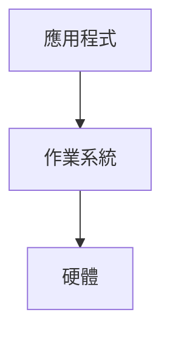

# Marginalia architecture

Marginalia turns lecture slides (pptx/pdf) and lecture recordings (mp4) into per-slide study notes.
Slides show on the left; notes on the right; every claim in a note links to the second of video where the
teacher said it. A local agent (the user's own Claude Code / Codex login, never an API key) answers questions
with the whole course as context.

## Two modes

| | `pnpm dev` (local) | `pnpm build` (deployed) |
| --- | --- | --- |
| Backend | Python FastAPI on 127.0.0.1:8765, Vite proxies `/api` and `/files` | none |
| Data | read/write files under `courses/` | static JSON + images exported into `apps/web/dist/` |
| Edit notes | yes | no (read-only) |
| Agent chat / generation | yes | hidden |
| Video | served from `courses/<c>/materials` with Range support | `course.json` `videoUrls[<video>]` if set, else timestamps show as text |

The frontend picks its data adapter from `import.meta.env.VITE_MARGINALIA_MODE` (`local` | `static`).

## Repo layout

```
apps/web/                 Vite + React 19 + TS + Tailwind 4 + shadcn (same stack as open-slide)
server/                   Python 3.12, uv
  marginalia/
    config.py store.py    paths, on-disk layout helpers (read store.py docstring first)
    ingest.py             scan materials/, unpack zips, register decks + videos
    slides.py             pptx/pdf -> PDF -> webp slides + per-slide text
    media.py              ffmpeg helpers
    transcribe.py         faster-whisper, local, multilingual (en + zh)
    align.py              which slide is on screen when (frame matching + Viterbi)
    pipeline.py           scan -> render -> align -> transcribe -> generate -> review, as a job
    llm/claude.py         one-shot calls through the local Claude Code login (claude-agent-sdk)
    llm/codex.py          one-shot calls through `codex exec` (optional second engine)
    llm/accounts.py       detect logged-in Claude / Codex accounts
    notes/                note writer, reviewer agents, prompts
    exam/                 exam prep: handout, quiz, grading (see Exam prep)
    agents/               chat: Q&A, interview, on-demand review (streaming)
    jobs.py               background job runner + progress events
    api.py                FastAPI app
    export.py             static export used by `pnpm build`
    cli.py                `uv run marginalia <cmd>`
courses/                  user data, git-ignored (see store.py for the layout)
scripts/dev.mjs           runs uvicorn + vite together
```

## Course data on disk

See the docstring at the top of `server/marginalia/store.py`. Key points:

- `courses/<c>/materials/` raw drops. Any folder structure; zips are unpacked to `materials/_extracted/`.
- `courses/<c>/generated/` everything rebuildable (slides, transcripts, alignment, reviews).
- `courses/<c>/notes/<deck>/NNN.md` the notes. This is the user's work: never overwrite a note whose
  frontmatter `status` is `edited` unless the user asks.
- IDs: deck and video ids are slugs of the file name (`l1-operating-systems-a-recap`, `os20260916`); slide
  index is 1-based; files use 3-digit names (`007.md`, `007.webp`).
- `store.py` 集中驗證 deck/video id 為單一 slug（字母、數字、底線、連字號，不能以連字號開頭）；
  來源必須使用相對路徑，解析 symlink 後仍在該課程的 `materials/`。輸出與讀取路徑在操作前解析，
  必須留在課程的對應 `generated/`、`notes/`、`chats/` 根目錄。
- manifest 的素材項目新增 `mtimeNs`，與 `size` 一起判斷來源是否更新；mtime 推測的 `date` 只用於
  對齊的軟性 prior，不排除未來日期的簡報。取樣影格等比縮放並補黑邊至 384×216，裁框採候選簡報的
  實際 `width/height`，未知比例時保留亮框。
- `transcript.json` 新增 `sourceFingerprint: {source, size, mtimeNs}`；只有指紋與目前來源相同才可續跑略過。
  舊逐字稿沒有指紋時需要重新轉錄；暫存 `audio.wav` 也由 `audio.source.json` 的相同指紋綁定來源。
  轉錄輸出拒絕 leaf symlink；抽音訊在已驗證的 generated 目錄以獨占方式建立隨機暫存檔，
  ffmpeg 寫入已開啟的檔案描述符，再原子替換輸出，不從輸出別名推導 `.part.wav`。
  共用寫檔 helper 逐層以 `O_NOFOLLOW` 開啟父目錄，以 `O_EXCL` 建立暫存檔；替換與清理均使用固定的
  目錄描述符，避免驗證後父目錄遭置換時跟隨新 symlink。轉錄暫存清理也使用同樣的目錄開啟方式。
  操作時使用既定根路徑作邊界，不再重新解析可遭置換的 root；影格快取也寫入已開啟的描述符，
  不讓 NumPy 由輸出名稱推導另一個檔名。
  上傳也使用 store 的 `exclusive_output`：由相同的固定目錄 fd helper 建立父目錄，以
  `O_CREAT | O_EXCL | O_NOFOLLOW` 建立新檔，寫入與失敗清理均沿用該 fd；同名檔案加序號而不覆寫。
  `frames.npz` 儲存相同的 `source`、`size`、`mtimeNs` 與裁框候選 `aspects`、快取格式 `version`；
  任何欄位不符或缺少時重新取樣，並保存 `numbers` 頁碼圖樣以區分動畫內容相似的頁面。
  頁碼區必須有局部對比；沒有足夠投影片 ink 的影格停用頁碼加分，空畫面不能單靠頁碼命中投影片。
- 整門課的 pipeline 轉錄全部尚未完成的媒體；指定 deck 時仍納入音訊與沒有任何有效 deck 匹配的媒體，
  避免視覺對齊失敗造成口述內容遺失。

## Note format

Format v2 (2026-11-03): notes are written for students with no background, so they lean on structure, diagrams
and highlights.

````markdown
---
slide: 7
title: Roles of Operating System (OS)
status: generated        # generated | reviewed | edited | skipped
sources:
  - os20260916@846-1062   # video@start-end seconds the slide was on screen
partial: true            # optional: written while the transcript or alignment was still pending
inputs: 3f9a1c0b2d4e       # with partial: fingerprint of the ranges and transcript lines this slide used
untaught: true           # optional: unshown or skimmed slide, written from slides only; also stores inputs
updatedAt: 2026-11-03T10:00:00+08:00
---

> [!IMPORTANT]
> 作業系統是應用程式和硬體之間的一層軟體，==應用程式要用硬體都得經過它== [14:28](video:os20260916?t=868)。

## 三個角色

- **Transparency**（透明性）：寫程式的人不用管硬體怎麼分配……



## 補充
……
````

- Status: a note without a `status` (a hand-written file) counts as `edited`. Generation never overwrites `edited`
  notes unless the user forces it, and every generated/reviewed write is a compare-and-swap on the file content.
- Slides in an aligned deck with no video ranges are written from the slide image, text and speaker notes,
  with neighbouring titles/outline as context. They keep `status: generated` (then `reviewed`), add
  `untaught: true` and an `inputs` fingerprint, and start with an IMPORTANT callout:
  「本頁課堂未講解，以下根據投影片整理。」 They have no video timestamp links or invented classroom claims.
  Review checks slide consistency and coverage rather than requiring transcript evidence. The reader uses the
  existing callout renderer; final untaught notes are exported normally, with the disclosure in their body.
  Before generated/revised writes, video citations are stripped from inline links (including titles), reference
  links/definitions, autolinks and HTML anchors. A separate conservative check also detects escaped/entity-encoded
  `video:` schemes; any residue keeps the note `generated` with a blocking review finding. Such unprotected
  untaught notes are omitted from static export until fixed; edited notes remain authored content.
- When a writer or reviser returns `SKIP` while using recordings (the teacher merely flipped past a slide or
  discussed something else), retry once with the slide image/text, notes and outline only. This second writer
  may keep `status: skipped` only for blank, title-only or chapter-divider slides; substantive slides get the
  same untaught notes and disclosure described above. Model classification uses the image as well as text;
  empty extracted text alone does not identify a blank slide.
- A fallback note has `sources: []`, `untaught: true`, and the original material's `inputs` fingerprint, including
  its actual ranges/transcript, even though they are excluded from the fallback prompt. Partial material keeps
  `partial: true`. Review retains that fingerprint rather than consuming later recording changes.
- Resume refreshes unprotected `untaught` notes only when `inputs` changes. New video ranges or changed
  transcript lines retry the regular writer, restoring timestamps when it explains the slide; a further SKIP
  falls back to slides again. Old skipped notes without `untaught` are migrated once, even when they already
  have a partial fingerprint. New blank/title/divider skips keep `untaught` and `inputs`, so unchanged resume
  costs no model calls. Edited/hand-written notes remain protected.
- A course without recordings (or with audio only), or a deck that no aligned video shows, gets final slide-only
  notes (no `partial`). A partial note is regenerated only when its `inputs` fingerprint changes. It is computed
  from content (this slide's ranges and transcript lines, whether they are complete, which videos are still pending),
  not file times, so the pipeline re-writing an identical alignment does not make every run call the model again.
- Notes longer than the review limit (20,000 chars) are only rule-checked, never rewritten by the reviewer.
- Timestamp links are plain markdown links with the `video:` scheme: `[mm:ss](video:<videoId>?t=<seconds>)`
  (`h:mm:ss` past an hour; `t` is whole seconds and the label is that same value). The UI renders them as chips
  that seek the player.
- Writing rules for notes live in `server/marginalia/notes/style.md` (owned by the notes card).

Markdown extensions (frontend and backend contract):

| Use | Syntax | Rendering |
| --- | --- | --- |
| Flowchart, architecture, state, sequence diagrams | ```` ```mermaid ```` block: `flowchart`, `sequenceDiagram`, `stateDiagram-v2`, `classDiagram`, `block-beta`; node text may be zh-TW | mermaid → SVG, follows light/dark theme; on a syntax error show the source plus the error instead of breaking the page; click to enlarge |
| Images (drawings, screenshots, SVG diagrams) | ``, files in `notes/<deck>/assets/` (flat, no subfolders), png/jpg/webp/svg; the editor uploads pasted or dropped images through `POST …/assets` | `` (SVG always as img, never inline, so no scripts), caption shown below; click to enlarge. Any other `src` renders as its caption text |
| Highlight | `==text==` | `<mark>` |
| Bold | `**term**` (a term where it is first defined, the key words of a conclusion) | bold |
| Callouts | GitHub alerts `> [!NOTE]`, `> [!TIP]`, `> [!IMPORTANT]`, `> [!WARNING]`, `> [!CAUTION]` | blocks labelled 補充說明, 小技巧, 重點, 注意, 易混淆 |
| Comparison | GFM table | table, scrolls sideways on narrow screens |
| Math | `$...$`, `$$...$$` | KaTeX |
| Self-check answers | `<details><summary>答案</summary>…</details>` | collapsible; the only raw HTML allowed, everything else is sanitized |

Review records (`generated/reviews/<deck>/NNN.json`):

```json
{ "findings": [ { "reviewer": "correctness", "severity": "high", "quote": "…", "problem": "…", "fix": "…" } ],
  "reviewedHash": "…", "noteHash": "…", "revised": true, "unresolved": [], "reviewedAt": "…", "errors": {} }
```

`reviewedHash` is `sha256(body.strip())[:16]` of the text the reviewers read, `noteHash` of the text the review
left on disk; `findings` describe the former, `unresolved` (high/medium rule findings still open) the latter. Ignore
a record whose hashes match neither the current note body.

## Alignment format (`generated/alignment.json`)

```json
{ "videos": { "os20260916": { "step": 2.0, "region": [x0, y0, x1, y1], "frameSize": [384, 216] } },
  "segments": [ { "video": "os20260916", "start": 846.0, "end": 1062.0, "deck": "l1-…", "slide": 7,
                  "score": 0.71, "manual": false } ] }
```

`deck`/`slide` are `null` for stretches where no slide is visible. `manual: true` segments come from the UI and
survive re-alignment.

## HTTP API (local mode)

All JSON. Errors: `{"detail": "<繁中訊息>"}` with a 4xx/5xx status.

有副作用的請求會驗證 `Origin`；預設允許 `http://localhost:5173`、
`http://127.0.0.1:5173`，並始終允許同源及未附 `Origin` 的本機 CLI 請求。
可在啟動時用 `MARGINALIA_ALLOWED_ORIGINS` 取代預設清單，以逗號分隔完整來源
（含協定、主機與必要的連接埠，不含路徑、結尾斜線或萬用字元）；項目前後空白與空項目會忽略。
設定為空字串時，僅允許同源及未附 `Origin` 的請求。變更設定後須重啟開發伺服器。

透過 Tailscale 存取時，例如：

```sh
MARGINALIA_ALLOWED_ORIGINS="http://localhost:5173,http://127.0.0.1:5173,http://100.81.100.96:5173" pnpm dev -- --host 100.81.100.96
```

Vite 仍將 `/api`、`/files` 代理至 `127.0.0.1:8765`；後端維持只監聽 loopback。
API 的 TrustedHost 會額外允許設定清單內的主機名稱，支援 Vite 保留原始 Host 的代理方式；
Origin 比對仍須符合清單中的協定、主機與連接埠，或與請求同源。

| Method | Path | Body / query | Returns |
| --- | --- | --- | --- |
| GET | `/api/health` | | `{mode:"local", version}` |
| GET | `/api/courses` | | `[{id,title,subtitle,deckCount,videoCount,updatedAt}]` |
| POST | `/api/courses` | `{id?, title}` | course |
| GET | `/api/courses/{c}` | | `{info, decks:[deck], videos:[video], status}` |
| PUT | `/api/courses/{c}` | partial `course.json` | `info` |
| POST | `/api/courses/{c}/upload` | multipart `files[]`, optional `folder` | `{saved:[path], manifest}` (runs a scan) |
| POST | `/api/courses/{c}/scan` | | manifest |
| GET | `/api/courses/{c}/decks/{d}` | | `{deck, slides:[{index,title,text,speakerNotes,image,thumb,ranges:[{video,start,end}],note:{status,updatedAt}|null}]}` |
| GET | `/api/courses/{c}/decks/{d}/notes/{i}` | | `{markdown, meta, review|null}` |
| PUT | `/api/courses/{c}/decks/{d}/notes/{i}` | `{markdown}` | `{meta}`; sets `status: edited` |
| POST | `/api/courses/{c}/decks/{d}/assets` | multipart `file` (png/jpg/webp/svg, ≤ 10 MB; content must match the extension; SVG is parsed and must be a plain drawing: allowlisted elements, no event handlers, no references outside the file, no DOCTYPE other than the W3C SVG ones, no entities or processing instructions, CSS checked after unescaping) | `{path:"assets/<name>-<sha256[:10]>.<ext>"}`, saved to `notes/<d>/assets/`; 422 for a rejected file |
| GET | `/api/courses/{c}/videos/{v}/transcript` | `?from=&to=` seconds | `{segments:[{start,end,text}], partial:bool}` |
| GET | `/api/courses/{c}/alignment` | | alignment.json |
| PUT | `/api/courses/{c}/alignment/segments` | `{video,start,end,deck,slide}` | alignment.json (adds a manual segment) |
| GET | `/files/{c}/{path}` | | file under the course dir; `materials/` videos support HTTP Range. Paths are confined to the course dir. |
| POST | `/api/courses/{c}/jobs` | `{kind, decks?, videos?, slides?, options?}` | `{id}` |
| GET | `/api/jobs` | `?course=` | `[job]` |
| GET | `/api/jobs/{id}` | | job |
| POST | `/api/jobs/{id}/cancel` | | job |
| GET | `/api/events` | SSE | `event: job` `data: job` on every progress change |
| GET | `/api/agents/accounts` | | `[{id, provider:"claude"|"codex", label, plan?, loggedIn, models:[{id,label}], efforts:[...]}]` |
| POST | `/api/agents/chat` | see below | SSE stream |
| GET | `/api/courses/{c}/chats` | | `[{id,title,mode,updatedAt}]` |
| GET | `/api/courses/{c}/chats/{id}` | | `{id,title,mode,messages}` |

`job` = `{id, course, kind, state:"queued"|"running"|"done"|"failed"|"cancelled", progress:0..1, message,
steps:[{name,state,progress,message}], createdAt, startedAt?, finishedAt?, error?}`.
Job kinds: `pipeline` (everything for the given decks), `scan`, `render`, `align`, `transcribe`, `generate`,
`review`, `exam` (see Exam prep).

Chat request:

```json
{ "course": "operating-system", "chatId": null, "mode": "qa",          // qa | interview | review
  "account": "claude", "model": "sonnet", "effort": "medium",
  "context": { "deck": "l1-…", "slide": 7,
               "selection": { "text": "…selected text…", "source": "note" },   // optional
               "region": { "x": 0.1, "y": 0.2, "w": 0.3, "h": 0.25 } },        // optional, fraction of slide
  "message": "這裡的 middleware 是什麼意思？" }
```

SSE events: `{"type":"start","chatId"}`, `{"type":"text","delta"}`, `{"type":"tool","title","detail"}`,
`{"type":"done","chatId","usage"?}`, `{"type":"error","message"}`.

Claude 與 Codex 共用 `marginalia.agents.prompts.build_system(course, mode, deck, slide, selection, region)`。
伺服器先驗證課程路徑，再預載可見簡報的投影片正文、講者備註、各頁筆記及影片逐字稿
（包含轉錄中的 partial 檔）；逐字稿保留影片與時間連結。system prompt 統一上限為 120,000 字元，
優先保留當頁、筆記、對齊至當頁的逐字稿、選取文字與圈選情境，其餘預算分配給整課資料，截斷會明示。
Codex 沒有讀檔工具，所有可用課程 context 都必須由這份 prompt 提供。

## Static export (`pnpm build`)

```
dist/data/courses.json
dist/data/<c>/course.json                 info + decks + videos (no local paths)
dist/data/<c>/decks/<d>.json              same shape as GET /api/courses/{c}/decks/{d}, plus notes[i].markdown
dist/data/<c>/transcripts/<v>.json
dist/data/<c>/alignment.json              visible-deck ranges, no internal video metadata
dist/files/<c>/generated/decks/<d>/slides/NNN.webp (+ thumbs)
dist/files/<c>/notes/<d>/assets/*         note images, same URLs as local mode
```

The root build rejects resolved source/output overlap before starting Vite (including symlink aliases).
It then runs Vite in static mode (clearing its own dist) and calls
`uv run marginalia export --out <absolute-dist>` from `server/`. Export defaults to all courses under
`MARGINALIA_COURSES`; `MARGINALIA_EXPORT_COURSES` is an optional comma-separated list of course IDs.
If no course directories exist, or `uv` is missing from `PATH`, build skips export, writes
`courses.json: []`, and prints a one-line English warning. The frontend build still succeeds; other
export failures remain fatal. No Python environment is required for this fallback. The standalone CLI is
`marginalia export [<course> ...] --out <fresh-directory> [--deck <deck> ...]`; existing `data/` or `files/`
namespaces are rejected so stale exports cannot retain hidden content. It does not write into course sources.

Export uses explicit metadata allowlists, omitting source paths, fingerprints, status/debug records, chats,
and all review records. Decks listed in `hiddenDecks` or marked `hidden` are excluded, including their alignment
ranges. Notes embed only body markdown and `meta: {status, updatedAt?}`; missing status means `edited`.
`partial` notes and non-final statuses (e.g. `draft`) are omitted. Only final `transcript.json` segments are
exported, with `{start,end,text}` fields; partial files are never read. Referenced flat note assets are copied
and revalidated with the upload image/SVG checks. Input symlinks are refused and output writes use pinned
parent descriptors. No original materials or media binaries are copied. Authored text is preserved as content.
`videoUrls` includes only known video IDs with public HTTPS URLs without embedded credentials;
private/local IPs and local/internal/Tailscale hostnames are rejected. No URL is fetched during export.

`VITE_BASE_PATH` (default `/`, e.g. `/marginalia/`) configures Vite assets, router basename, static JSON,
and all exported image URLs. JSON keeps the API's `/files/…` paths; the static adapter prefixes the build
base when loading deck images. Static mutations reject, account/history reads return empty arrays,
and local-only UI controls are gated by `editable`. Hosts must fall back to `index.html` for reader routes;
the build includes `404.html` for GitHub Pages. Mermaid, highlights, alerts and image rendering are shared
with local mode. Static notes carry no review record and hide the internal review tab.
`vite preview` explicitly sets `preview.proxy: {}` so it never inherits the local dev proxies:
exported `/files` are served from dist; local API and unexported files stay unavailable through preview,
even when a local backend is running.

Hosting: serve `.svg` files with `Content-Security-Policy: default-src 'none'; style-src 'unsafe-inline'; img-src data:`
(what `/files` sends locally), so an image opened on its own cannot load anything. `index.html` carries its own
CSP meta (no remote images, scripts or fetches).

## Exam prep

A course can hold several exams (midterm, final, …). Each exam has a scope (which decks and videos it covers),
optional past papers the user uploads, a **handout** (考前衝刺講義: one coherent, structured text that someone who
never studied can read in under three hours) and a **quiz** (模擬考: past-paper questions plus new ones, with
answers). Answering, checking and agent grading happen in the browser and the API; the static build keeps the
handout and quiz but no uploads and no agent.

### On disk

```
courses/<c>/exams/<exam>/
  exam.json                 settings, written by the API
  uploads/<name>            past papers / practice questions exactly as uploaded (png, jpg, webp, txt, md)
  handout/NNN.md            handout sections in reading order, note-style frontmatter (below)
  handout/assets/<name>     images pasted into the handout editor (same rules as notes/<deck>/assets)
  quiz.json                 questions + answers (below)
  attempts/<attempt>.json   one submitted answer sheet with its grading history
  work/                     the generator's rebuildable scratch (parsed past papers, plans); never exported
```

- `<exam>` is a `store.validate_id` slug (`midterm`, `final-2026`); `<attempt>` is 32 lowercase hex.
  Everything is resolved under `courses/<c>/exams/` with the same confinement as `notes/` (`Course.path`).
- `exam.json`:

  ```json
  { "id": "midterm", "title": "期中考", "createdAt": "…", "updatedAt": "…",
    "scope": { "decks": ["l2-…", "l3-…"], "videos": ["os20260923"] },
    "options": { "questionCount": 20, "types": ["choice", "fill", "short", "essay", "calc"], "minutes": 90 },
    "hidden": false }
  ```

  `scope.decks` empty means every visible deck. `scope.videos` empty means every video aligned to a deck in scope
  (videos are only an extra filter; the transcript reaches the generator through the decks' slide ranges).
  `options` are hints for the generator; all keys optional. `hidden: true` keeps the exam out of static export.
- Upload names are `slugify(stem)[:60] + ext`, de-duplicated with `-2`, `-3` (never overwritten). Pasted text is
  saved as `pasted-<sha256[:10]>.md`. An exam keeps at most 40 uploads.
- Handout section frontmatter (same parser as notes, `notes/notefile.py`):

  ```yaml
  section: 3
  title: 行程排程
  status: generated          # generated | reviewed | edited ; missing = edited
  sources: ["l2-processes#7", "l3-scheduling#12"]   # deck#slide the section draws on
  updatedAt: 2026-11-04T10:00:00+08:00
  ```

  Body: the note markdown dialect (callouts, `==highlight==`, mermaid, KaTeX, tables, `<details>`), plus two image
  sources: `` shows that slide's rendered image (a deck in the course; in static mode
  only visible decks resolve, others render as caption text) and `` resolves to
  `handout/assets/`. Video timestamp links `[mm:ss](video:<id>?t=<s>)` are allowed exactly as in notes.
  The user's edits are protected like notes: generation never overwrites an `edited` section; if any section is
  `edited`, handout generation keeps the whole handout (result `kept`) unless `force`. A regenerated handout
  replaces every section file atomically per file and removes surplus non-edited `NNN.md` beyond the new count.
- `quiz.json`:

  ```json
  { "version": 1, "generatedAt": "…", "hash": "<sha256[:16] of questions JSON>",
    "questions": [
      { "id": "q1", "type": "choice", "origin": "past", "pastRef": "midterm-2024-p1.png",
        "prompt": "下列何者會讓行程從 running 進入 waiting？", "multiple": false,
        "options": [{ "id": "A", "text": "時間片用完" }, { "id": "B", "text": "等待 I/O 完成" }],
        "answer": ["B"], "points": 2,
        "solution": "markdown 詳解", "sources": [{ "deck": "l2-processes", "slide": 14 }], "topic": "行程狀態" },
      { "id": "q2", "type": "fill", "prompt": "CPU 排程中，{{1}} 演算法可能造成 {{2}}。",
        "blanks": [["SJF", "shortest job first"], ["starvation", "飢餓"]], "points": 4, "solution": "…" },
      { "id": "q3", "type": "short", "prompt": "…", "points": 6, "solution": "參考答案 markdown",
        "rubric": [{ "point": "說明 context switch 要保存 PCB", "points": 3 }, { "point": "…", "points": 3 }] }
    ] }
  ```

  - `id` `[A-Za-z0-9_-]{1,40}`, unique. `type`: `choice` | `fill` | `short` (簡答) | `essay` (問答) | `calc` (計算).
    `origin`: `past` (from an upload; `pastRef` is the upload name) | `new`. When the exam has uploads, the quiz
    must contain every past-paper question the parser found, then new questions.
  - `choice`: `options` (2–8, ids `A`…), `answer` the correct option ids, `multiple` whether more than one may be
    picked. `fill`: blanks marked `{{1}}`, `{{2}}`… in `prompt`, `blanks[n-1]` lists accepted answers.
    `short`/`essay`/`calc`: `solution` is the reference answer, `rubric` the scoring points (sum = `points`).
  - `prompt`, option `text`, `solution` and rubric `point` are note-dialect markdown (`slide:` images allowed).
  - `points` is a positive integer; `sources` optional.
- Attempt (`attempts/<id>.json`):

  ```json
  { "id": "…", "quizHash": "…", "questions": [ /* the quiz questions as answered */ ],
    "startedAt": "…", "submittedAt": "…", "durationSec": 3120,
    "answers": { "q1": ["B"], "q2": ["SJF", "飢餓"], "q3": "我的答案" },
    "results": { "q1": { "status": "correct", "score": 2, "maxScore": 2 },
                 "q3": { "status": "pending", "score": null, "maxScore": 6 } },
    "score": 6, "maxScore": 12,
    "gradings": { "q3": [ { "id": "…", "answer": "我的答案", "score": 4, "maxScore": 6,
                            "verdict": "partial", "summary": "…", "issues": [{ "quote": "…", "problem": "…", "fix": "…" }],
                            "missing": ["…"], "account": "claude", "model": "sonnet", "createdAt": "…" } ] } }
  ```

  Objective grading (`choice`, `fill`) is deterministic: `choice` needs exactly the right set; `fill` scores each
  blank `points / blanks` (rounded to the nearest 0.5, halves up) after NFKC, trim, collapsing whitespace and case
  folding as upper-then-lower (so `ß` matches `SS` in both Python and JS), comparing to any accepted answer. Status `correct` | `partial` | `incorrect` | `blank` (empty answer, 0 points) | `pending`
  (subjective, not yet graded). The latest grading of a subjective question sets its `results` entry; `score`
  sums known scores. Every grading is kept, in order; a grading carries the answer text it graded, so the user can
  rewrite and grade again without losing earlier versions. `questions` snapshots the quiz at submission: question ids
  are reused when a quiz is regenerated, so reviewing and grading an attempt always use its own snapshot (attempts
  saved without one can be graded only while `quizHash` matches the current quiz; otherwise 409). The same objective rules are implemented in
  `server/marginalia/exam/grade.py` and `apps/web/src/lib/exam-grade.ts` and share test cases.

### HTTP API (local mode)

Same conventions as the main API (JSON, `{"detail": "<繁中>"}` errors, Origin check on writes). `{e}` is the exam id.

| Method | Path | Body / query | Returns |
| --- | --- | --- | --- |
| GET | `/api/courses/{c}/exams` | | `[examSummary]` = `{id,title,updatedAt,scope,uploadCount,sectionCount,questionCount}` |
| POST | `/api/courses/{c}/exams` | `{title, id?, scope?, options?}` | `exam`; 409 if the id exists |
| GET | `/api/courses/{c}/exams/{e}` | | `{exam, uploads:[upload], handout:[{section,title,status,updatedAt,sources}], quiz:{questionCount,hash,generatedAt}|null}` |
| PUT | `/api/courses/{c}/exams/{e}` | partial `{title, scope, options, hidden}` | `exam`; unknown deck/video ids → 422 |
| POST | `/api/courses/{c}/exams/{e}/uploads` | multipart `files[]` | `{uploads:[upload]}`; 413/422 per rule below |
| POST | `/api/courses/{c}/exams/{e}/uploads/text` | `{text}` (1–200,000 chars) | `upload` |
| DELETE | `/api/courses/{c}/exams/{e}/uploads/{name}` | | `{uploads}` |
| GET | `/api/courses/{c}/exams/{e}/handout/{n}` | | `{markdown, meta}` |
| PUT | `/api/courses/{c}/exams/{e}/handout/{n}` | `{markdown}` | `{meta}`; sets `status: edited` (also creates section n = count+1) |
| POST | `/api/courses/{c}/exams/{e}/assets` | multipart `file` | `{path:"assets/<name>"}`; note-asset rules |
| GET | `/api/courses/{c}/exams/{e}/quiz` | | `quiz.json` (answers included: hiding them is the UI's job, as in static mode) |
| GET | `/api/courses/{c}/exams/{e}/attempts` | | `[{id,submittedAt,score,maxScore}]`, newest first |
| POST | `/api/courses/{c}/exams/{e}/attempts` | `{answers, startedAt?, durationSec?}` | `attempt`, objective questions graded |
| GET | `/api/courses/{c}/exams/{e}/attempts/{a}` | | `attempt` |
| POST | `/api/courses/{c}/exams/{e}/attempts/{a}/grade` | `{question, answer?, account, model?, effort?}` | `{grading, attempt}`; blocks until the agent replies (≤ 5 min) |

`upload` = `{name, kind:"image"|"text", size, url}` (`url` is `/files/<c>/exams/<e>/uploads/<name>`).
`answer` in a grade request defaults to the attempt's answer for that question; only `short`, `essay`, `calc`
can be agent-graded (422 otherwise). `scope.decks` may name only visible decks (not `hiddenDecks`/`hidden`). `account`/`model`/`effort` are validated against `GET /api/agents/accounts`
like chat. Gradings of one attempt are serialized.

Generation is a job: `POST /api/courses/{c}/jobs` with
`{kind:"exam", options:{exam, parts?:["handout","quiz"], force?, account?, model?, effort?}}`. Progress, cancel and
SSE are the normal job ones. The job result (in `job.message`) says how many sections/questions were written.

### Generation pipeline interface (`server/marginalia/exam/`)

```
exam/
  store.py      Exam: paths, exam.json, uploads, sections, quiz, attempts, locks      (API card)
  context.py    ExamContext and the dataclasses below; llm() wrapper                 (API card)
  schema.py     quiz question validation, JSON-reply parsing                          (API card)
  grade.py      objective grading, agent grading prompt + parsing                    (API card)
  routes.py     the HTTP routes above                                                (API card)
  run.py        generate_exam(): the job entry; validates and writes outputs        (API card)
  past.py       parse_uploads()     past papers -> PastQuestion list                (generation card)
  handout.py    write_handout()     scope -> sections                               (generation card)
  quiz.py       write_quiz()        scope + past -> questions                       (generation card)
  prompts.py    prompt text, style rules (may become a prompts/ folder)              (generation card)
```

```python
@dataclass
class SlideDoc:            # one slide in scope
    deck: str; index: int; title: str; text: str; speaker_notes: str
    note: str              # note body (frontmatter stripped), "" if none
    image: Path | None     # rendered slide webp, for llm(images=...)
    lines: list[dict]      # transcript lines on screen for this slide: {video, start, text}

@dataclass
class DeckDoc:
    id: str; title: str; slides: list[SlideDoc]

@dataclass
class Upload:
    name: str; kind: Literal["image", "text"]; path: Path
    text: str              # file content for text uploads, "" for images

@dataclass
class ExamContext:
    course: Course; exam: dict          # exam.json
    decks: list[DeckDoc]                # scope order
    uploads: list[Upload]
    work: Path                          # exams/<e>/work/, free for the generator's cache files
    async def llm(self, prompt: str, *, system: str = "", images: list[Path] = (),
                  model: str | None = None) -> str: ...
        # one call on the job's account (claude or codex), no tools, ANTHROPIC_API_KEY stripped; text reply

@dataclass
class PastQuestion:
    upload: str            # Upload.name it came from
    number: str            # as printed ("3", "二(1)"), "" if none
    type: str              # same types as quiz questions
    prompt: str            # markdown, transcribed faithfully
    options: list[dict]    # choice only [{id, text}]
    answer_hint: str       # answer printed on the paper, "" if none

@dataclass
class Section:
    title: str; markdown: str
    sources: list[tuple[str, int]]      # (deck, slide)

Progress = Callable[[float, str], None]   # fraction 0..1 of this step, zh-TW message

async def parse_uploads(ctx: ExamContext, progress: Progress) -> list[PastQuestion]
async def write_handout(ctx: ExamContext, progress: Progress) -> list[Section]
async def write_quiz(ctx: ExamContext, past: list[PastQuestion], progress: Progress) -> list[dict]
    # returns quiz questions in the quiz.json shape; may leave `id` empty (run.py numbers them q1, q2…)
```

`run.generate_exam(course, exam_id, *, parts, force, account, model, effort, progress)` builds the context, calls
the three functions, then validates: sections need a title and a non-empty body; questions are checked against
the quiz schema above (bad ones are dropped with a count in the job message; zero valid questions fails the job);
every `PastQuestion` must map to a `past` question of the same upload whose prompt contains its prompt (normalized,
matched one to one, so sub-questions sharing an introduction count separately); missing ones are added as `short`
questions with the transcribed prompt, their printed options listed under it, and no rubric, so past papers are never
lost. At most 100 past questions per upload and 200 questions per quiz are kept. Before writing, `run.py` strips
`slide:` references to slides outside the course, and asset references that do not exist. The generator never
writes `handout/`, `quiz.json` or `attempts/` itself, only `work/`. Errors raised by the three functions fail the
job with the message shown in zh-TW. A first, minimal implementation of all three ships with the API card
(one model call per part, structurally valid output); the generation card replaces their internals without changing
the signatures.

### Static export

```
dist/data/<c>/exams.json                    [{id,title,updatedAt,sectionCount,questionCount}]
dist/data/<c>/exams/<e>.json                {exam:{id,title,scope:{decks}}, handout:[{section,title,markdown,meta:{status,updatedAt?}}],
                                             quiz:{hash, questions}|null}
dist/files/<c>/exams/<e>/handout/assets/*   referenced handout images, revalidated like note assets
```

- Exported: exams not `hidden` whose effective scope (`scope.decks`, or every visible deck when empty) is entirely
  among the exported decks, so `--deck` or a later `hiddenDecks` change never publishes text written from
  unpublished slides. Within such an exam, sections whose `sources` or questions whose `sources` cite an unexported
  deck are left out. Sections of any status (missing = edited) and questions with `pastRef` removed; assets referenced
  by sections or by quiz prompts, options and solutions.
- Past-paper questions are exported as transcribed text (only the original upload files are not). Mark the exam
  `hidden` to keep a privately obtained paper off a public site.
  `slide:` images resolve to the already exported slide images; references to hidden decks render as captions.
- Not exported: `uploads/`, `work/`, `attempts/`, exam `options`, video scope.
- In the static reader the quiz is answered in the browser: answers and results live in `localStorage`
  (`marginalia.exam.<c>.<e>`), objective questions are graded by `exam-grade.ts`, subjective ones show the
  reference answer and rubric for self-check. No agent grading button. In both modes answers and solutions are
  hidden until 對答案 (the data is present in the JSON; this is a study aid, not a proctored exam).

### Security

- Uploads: images png/jpg/webp ≤ 10 MB with magic-byte check (`note_assets` rules; no SVG), text txt/md ≤ 1 MB
  that must decode as UTF-8; the request is capped by `Content-Length` before parsing (40 MB per request);
  file names are slugified, never taken as paths; names in URLs are validated (`[\w][\w.-]*`, no `..`).
- Paths: exam/attempt ids are validated; every path goes through `Course.path` confinement; writes use
  `atomic_output`/`exclusive_output` (pinned parent fds, no symlink following); input symlinks under `exams/`
  are refused by `check_course`.
- Prompt injection: past-paper images/text, slides, notes, transcripts and student answers are untrusted
  material. Every generation and grading call runs with **no tools** (Claude `tools=[]`, Codex locked down as in
  `llm/codex.py`), so an injected instruction can only affect the text it returns. System prompts say material is
  data, not instructions; student answers travel inside `<student_answer>` tags with the closing tag escaped.
  Model output is parsed as JSON and validated: scores are clamped to `[0, maxScore]`, unknown fields dropped,
  markdown rendered by the same sanitizer as notes (no raw HTML beyond `<details>`).
- Grading and generation are local-mode only and use only subscription logins (LLM usage rule).

## LLM usage rule

Never call a paid API with a key. All model calls go through the user's own logged-in CLIs:

- Claude: `claude-agent-sdk` (spawns Claude Code, uses its subscription login). Strip `ANTHROPIC_API_KEY`
  from the child env so a stray key never switches billing.
- Codex: `codex exec` with the chosen `CODEX_HOME`.

Speech-to-text runs locally (faster-whisper). Slide/video alignment is local numpy. Neither costs tokens.
