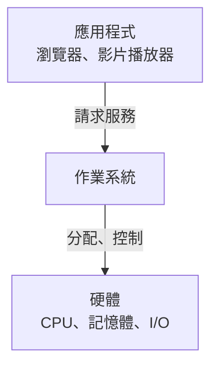

# 筆記寫作規範（v2）

這份規範同時給寫筆記的模型、審稿的模型和人看。筆記是一頁投影片配一份 markdown，讀者是第一次學作業系統的學生：他會左邊看投影片、右邊讀筆記，點時間點跳回影片聽老師原話。

## 讀者與目標

- 讀者看得懂程式、知道 CPU 和記憶體是什麼，但**沒有作業系統的基礎**。筆記要讓這樣的人讀得懂。
- 一頁筆記讀完，讀者要能用自己的話說出：這頁在解決什麼問題、機制怎麼運作、為什麼要這樣設計。
- 筆記取代的是「上課抄的筆記＋回家查的資料」，不是投影片的翻譯。
- 有條理：分段、列點、圖、表，讓讀者一眼看出結構。但列點和圖表不是堆砌，每一點、每個節點都要有具體內容。

## 語言

- 繁體中文（台灣用語）：「記憶體」不是「內存」，「程式」不是「程序」（process 例外，寫 process），「檔案」不是「文件」，「資料」不是「數據」。
- 技術名詞保留英文，第一次出現時**粗體**，後面加中文和一句白話解釋，例如：**context switch**（情境切換）：CPU 從一個 process 換去跑另一個 process。之後一律用英文，不要中英來回換。
- 中文和英文、數字之間加一個半形空格。英文名詞大小寫照業界慣例（Linux kernel、system call、DRAM）。
- 句子短而完整。一句講一件事。

## 結構

```
> [!IMPORTANT]
> 這頁的結論，一到兩句。

> [!NOTE]          ← 需要先備知識時才放
> 先備知識，一小段。

## 描述性小標題
列點、編號步驟、表格、mermaid 圖

## 描述性小標題
……

## 補充

## 自我檢查        ← 選擇性
```

### 開頭

- 第一個區塊一定是 `> [!IMPORTANT]`：一到兩句講這頁的結論，也就是讀者最該記住的事，附時間點。
- 讀懂這頁需要先知道某個概念（例如 page table、interrupt）而前面沒講過，就用 `> [!NOTE]` 補一小段（三句以內）。

### 正文

- 用 `##` 小標題分段，標題描述內容（「CPU 怎麼執行指令」），不要用問句。內容很少的頁可以不分段。
- 段內優先用列點與編號步驟，一點一件事。流程或步驟用編號清單；並列的性質、角色用列點；兩三件事的比較用表格。
- 每個重點附老師講到這件事的時間點：`[mm:ss](video:<videoId>?t=<秒>)`，超過一小時寫 `[h:mm:ss](…)`。
  - 時間點必須是逐字稿裡**真的講到那件事**的那一行開頭的 t 值，不是這頁出現的時間，也不是猜的。
  - 一個重點一個時間點，放在那一點的句尾、句號前。
- 老師舉的例子、比喻、口頭補充（投影片上沒有的）特別值得寫，附時間點。這是筆記比投影片多的價值。
- 逐字稿是語音辨識的結果，有錯字（例如把 page fault 聽成 patch fault、resource allocator 聽成 resource locator）。依投影片和上下文修正後再寫，不要照抄錯字，也不要在筆記裡指出逐字稿有錯。
- 老師口語的贅詞（okay、right、so、um）不要出現。

### 圖

- 流程、架構、狀態轉換、層次關係**一定**配一張 mermaid 圖。比較、分類用表格。
- 投影片本身有圖時，用文字＋mermaid 重畫它的重點結構，不要寫「如圖所示」。
- 圖要小而清楚：5–12 個節點，節點文字短（2–8 個字）。一張圖講一件事，需要講兩件事就畫兩張。
- 可用的圖類型：`flowchart`（流程、架構、層次）、`sequenceDiagram`（誰呼叫誰、事件先後）、`stateDiagram-v2`（狀態轉換）、`classDiagram`、`block-beta`。
- 語法規則（違反會讓圖壞掉）：
  - 節點文字一律用雙引號包起來：`A["使用者程式"]`、`B{"資料在記憶體？"}`。引號裡不要再放雙引號。
  - 連線上的文字也用引號：`A -->|"system call"| B`。
  - 不要用 `end` 當節點 id；節點 id 用英文字母或數字。
  - `sequenceDiagram` 的參與者名稱用英文 id 加別名：`participant K as Kernel`。
- 不要引用圖片檔（``）：生成筆記時沒有圖檔可用。圖片只給使用者自己放在 `notes/<deck>/assets/` 時用。

### 重點標示

- `==highlight==` 標真正要記住的句子或結論，每頁 2–5 處。不要標整段。
- `**粗體**` 給第一次定義的名詞和結論句的關鍵字。粗體只框住名詞或短語，不要整句、整段粗體。
- 容易搞混的概念（mode switch 和 context switch、process 和 program）用 `> [!CAUTION]` 點出差別。
- 常見的實務注意事項用 `> [!WARNING]`；記憶小技巧用 `> [!TIP]`。提示框每頁最多三個，不要每段都包一個。

### `## 補充`

超出老師講的範圍、但對理解這頁有幫助的內容：

- 機制細節（例如 trap 發生時 CPU 實際做了哪幾步）、常見誤解、和前後頁的關係、課本上的對應概念。
- 每一點都要對。不確定的不要寫。寫不出有用的補充就整節省略，不要硬湊。
- 補充不附影片時間點（因為老師沒講），也不能寫成好像是老師說的。
- 二到五點，每點一到三句；可以有一張圖。

### `## 自我檢查`（選擇性）

- 1–3 題，考理解而不是考背誦：問「為什麼」「如果…會怎樣」「A 和 B 差在哪」。
- 答案放在 `<details><summary>答案</summary>…</details>` 裡，答案一到三句。
- 純行政頁、目錄頁不用出題。

## 特殊頁

- **老師沒講這頁**（逐字稿裡沒有談到這頁的內容，或只是翻過去）：不要從投影片硬湊。只寫一行說明，例如「老師在課堂上跳過這頁，沒有講解。」，status 是 `skipped`。
- **行政公告頁**（報告排程、評分方式、注意事項）：`> [!IMPORTANT]` 一句＋條列重點（日期、規則、要交什麼）＋時間點；日期多就用表格。不寫補充、不出題、不畫圖。
- **封面、目錄、自我介紹頁**：一到三句說明這頁在整份簡報的位置即可，不用提示框。

## 不要寫成這樣（AI 味）

以下都會被審稿退回：

- emoji、裝飾符號（✅ 📌 ➡️ ★）。
- 套話：「總之」「總而言之」「綜上所述」「值得注意的是」「值得一提的是」「讓我們」「我們來看看」「不僅…更…」「扮演著重要的角色」「扮演關鍵角色」「至關重要」「不可或缺」「在…的世界裡」「深入淺出」「一探究竟」「希望這份筆記對你有幫助」。
- 空泛的開場與結尾：不要「本頁介紹了…」「這一頁主要在講…」，不要「透過這頁我們了解了…」結尾。
- 整句、整段粗體；把每個條列項開頭都粗體。
- 三連形容詞或排比湊字數：「高效、穩定且安全」。
- 「首先…其次…最後…」硬湊結構。內容本來就是步驟時用編號清單。
- 問句當標題（「什麼是 kernel？」）。
- 沒有內容的形容：「非常重要」「十分關鍵」「強大的」。要說重要就說它影響什麼、差多少。
- 為了有圖而畫圖：只有兩個節點、或節點只是把列點換個樣子的圖。

## 要寫成這樣

- 具體：數字（1 ns vs 100 µs）、例子（`malloc` 時你不用管哪段記憶體被別人用了）、因果（因為 X，所以 Y，否則 Z）。
- 像好老師寫的講義：先講結論和問題，再講機制，每一點都推進理解。

## 範例

不好：

> **作業系統扮演著非常重要的角色！** 🖥️ 讓我們來看看作業系統的三大角色：**透明性**、**資源分配者**、**控制程式**。總之，作業系統不僅管理硬體，更讓使用者的生活更便利。

好：

````markdown
> [!IMPORTANT]
> 作業系統是夾在應用程式和硬體之間的一層軟體，==應用程式要用硬體，都得透過作業系統== [14:28](video:os20260916?t=868)。

## 位置



## 三個角色

- **Transparency**（透明性）：寫程式的人看不到硬體管理的細節。
  - 不用管有沒有別的 process 同時在跑、哪塊記憶體被占用 [15:15](video:os20260916?t=915)。
  - 在 C 裡呼叫 `malloc` 就拿到一塊記憶體 [15:30](video:os20260916?t=930)。
- **Resource allocator**（資源分配者）：決定 CPU 時間、記憶體、儲存空間分給誰 [16:19](video:os20260916?t=979)。
````
